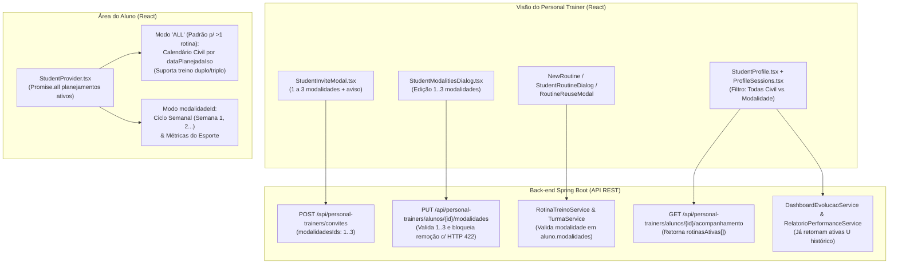
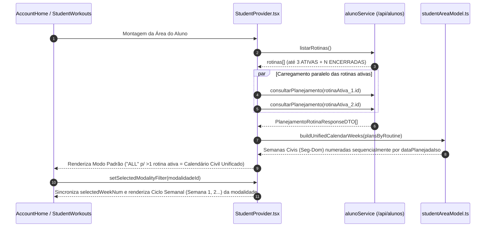

# Suporte Full-Stack a Atleta Híbrido (Múltiplas Modalidades e Rotinas Ativas)

*   **Author:** Equipe Gymnasion (`regetz`)
*   **Status:** Implemented (Backend + Frontend Verified)
*   **Date:** 2026-11-11

--------------------------------------------------------------------------------

## Overview

Esta especificação define a arquitetura e o plano de implementação full-stack (back-end Spring Boot em `/Users/regetz/Documents/tcc` e front-end React em `/Users/regetz/Documents/Projetos/Gymnasion_web`) para suportar o **Atleta Híbrido** na plataforma SaaS Gymnasion. Um atleta híbrido é um aluno vinculado a mais de uma modalidade esportiva sob a consultoria do mesmo Personal Trainer — por exemplo, um nadador que realiza treinos complementares de musculação na academia.

Com esta evolução, cada aluno poderá possuir de **1 a 3 modalidades esportivas** vinculadas ao seu perfil (configuráveis já no convite de cadastro ou editáveis posteriormente no perfil do aluno) e manter **até 1 rotina de treino ativa por modalidade vinculada** (máximo de 3 rotinas ativas simultâneas em esportes distintos). Quando o aluno possuir mais de uma rotina ativa simultânea, a Área do Aluno e o painel de acompanhamento do Personal Trainer exibirão, por padrão, um **calendário semanal unificado pelas datas reais do calendário civil** (`dataPlanejadaIso`), acompanhado de um filtro por modalidade para inspecionar o ciclo semanal (`Semana 1`, `Semana 2`...) e métricas específicas de cada esporte. Além disso, nenhuma tela do front-end exibirá códigos internos de engenharia (`US-*`, `C*`, `RN-*`) para alunos ou Personal Trainers.

*   **Impacto e Critérios de Sucesso (Exames de Validação):**
    *   **Exame Intermediário (Contratos e Domínio):** Criação de convite com 1 a 3 modalidades, edição de modalidades no perfil do aluno bloqueando remoção com `HTTP 422 Unprocessable Entity` quando houver rotina ou turma ativa na modalidade, validação de modalidade também na inclusão em turmas (`TurmaService`), preservação de 100% do histórico de treinos/evolução após remoção de modalidade inativa, e permissão de até 3 rotinas ativas em modalidades distintas.
    *   **Exame Final (Experiência Ponta a Ponta):** Um aluno com rotinas ativas de Natação e Musculação visualiza em [`AccountHome.tsx`](../../src/pages/AccountHome/AccountHome.tsx) e [`StudentWorkouts.tsx`](../../src/pages/StudentWorkouts/StudentWorkouts.tsx) todas as sessões liberadas agrupadas por data civil (incluindo dias de treino duplo), consegue alternar o filtro para uma modalidade isolada, registra a execução das sessões atualizando ambas as visões sem inconsistência de estado e navega por toda a interface sem visualizar códigos internos de requisitos.

## The Problem

### Estado Atual e Limitações

Na primeira versão do Gymnasion, o domínio de execução e vínculo foi construído sob a premissa de que cada aluno praticaria um único esporte por vez e teria no máximo **1 rotina ativa global**. Em testes reais com Personal Trainers, essa restrição impediu a prescrição combinada de modalidade principal + preparação física complementar.

Hoje, seis gargalos técnicos impedem o funcionamento completo do Atleta Híbrido:

1.  **Convite restrito a uma única modalidade (`1:1`):** O endpoint `POST /api/personal-trainers/convites`, o tipo [`ConviteAlunoPayload`](../../src/types/student.ts) e o componente [`StudentInviteModal.tsx`](../../src/components/StudentInviteModal/StudentInviteModal.tsx) aceitam apenas um `modalidadeId` escalar (com `@NotNull` em [`GerarConviteRequestDTO.java`](../../../tcc/src/main/java/com/gymnasion/tcc/dto/GerarConviteRequestDTO.java)).
2.  **Ausência de gestão de modalidades no perfil do aluno:** Embora `AlunoResponse.modalidades` em [`src/types/student.ts`](../../src/types/student.ts) já retorne um array `Modalidade[]` (mapeado na tabela associativa `praticada` em [`Aluno.java`](../../../tcc/src/main/java/com/gymnasion/tcc/domain/Aluno.java)), não existe endpoint REST nem interface em [`StudentProfile.tsx`](../../src/pages/StudentProfile/StudentProfile.tsx) para adicionar ou remover modalidades de um aluno já cadastrado. Como [`classifyStudentsForRoutine`](../../src/features/routines/routineModel.ts) exige que a modalidade da rotina conste em `student.modalidades`, o aluno nunca se torna elegível para o segundo esporte.
3.  **Lacunas de validação de modalidade no back-end e em modais do front-end:** Enquanto [`classifyStudentsForRoutine`](../../src/features/routines/routineModel.ts) e [`RoutineAssignModal.tsx`](../../src/components/RoutineAssignModal/RoutineAssignModal.tsx) já filtram por `modalityId` quando informado, o modal [`StudentRoutineDialog.tsx`](../../src/components/StudentRoutineDialog/StudentRoutineDialog.tsx) não filtra pelas modalidades do aluno, [`RoutineReuseModal.tsx`](../../src/components/RoutineReuseModal/RoutineReuseModal.tsx) omite o `modalityId` ao chamar `eligibleStudentsForRoutine`, [`NewRoutine.tsx`](../../src/pages/Routines/NewRoutine.tsx) pré-seleciona sempre `student.modalidades[0]` mesmo quando ocupada, e no back-end [`RotinaTreinoService.java`](../../../tcc/src/main/java/com/gymnasion/tcc/service/RotinaTreinoService.java) e [`TurmaService.java`](../../../tcc/src/main/java/com/gymnasion/tcc/service/TurmaService.java) ainda não verificam se a modalidade pertence a `aluno.getModalidades()`.
4.  **Descarte de rotinas secundárias na Área do Aluno:** Em [`StudentProvider.tsx`](../../src/features/studentArea/StudentProvider.tsx), a expressão `const rotinaAtiva = rotinas.find((r) => r.ativo) || rotinas[0];` seleciona apenas a primeira rotina ativa retornada pela API. Qualquer segunda ou terceira rotina ativa fica invisível para o aluno em [`AccountHome.tsx`](../../src/pages/AccountHome/AccountHome.tsx) e [`StudentWorkouts.tsx`](../../src/pages/StudentWorkouts/StudentWorkouts.tsx).
5.  **Descompasso cronológico entre `numeroSemana` de rotinas distintas:** O planejamento de cada rotina (`PlanejamentoRotinaResponseDTO` em [`src/types/rotina.ts`](../../src/types/rotina.ts)) numera as semanas relativamente à data de início daquela rotina (`Semana 1`, `Semana 2`...). Quando um aluno possui duas rotinas iniciadas em datas diferentes, a `Semana 1` de uma rotina não corresponde à mesma semana do calendário civil que a `Semana 4` da outra.
6.  **Exposição indevida de códigos internos (`US-*`, `RN-*`, `C*`) na UI do front-end:** Nove componentes atuais exibem siglas internas da especificação de engenharia diretamente em textos visíveis para alunos e Personal Trainers.

### Nova Abordagem

Substituir a restrição global por um modelo de **cardinalidade limitada por modalidade ($1 \le \text{modalidades} \le 3$, máximo de 1 rotina ativa por modalidade do aluno)** combinado com:
*   Seleção de 1 a 3 modalidades no convite e edição de modalidades no perfil do aluno com proteção de integridade (`HTTP 422` contra remoção de modalidade com rotina ou turma ativa e preservação de histórico para modalidades removidas);
*   Calendário semanal unificado na Área do Aluno e no Perfil do Aluno (quando o aluno possui $> 1$ rotina ativa) baseado nas **datas reais do calendário civil** (`dataPlanejadaIso` dentro das semanas liberadas — semana atual e semana anterior da rotina, ocultando semanas futuras), com alternância por filtro para a visão de microciclo (`Semana 1`, `Semana 2`...) de cada modalidade isolada;
*   Remoção integral de códigos internos (`US-*`, `C*`, `RN-*`) de todos os textos visíveis ao usuário no front-end.

## Goals

*   **G1 — Convite Multi-Modalidade (1 a 3 esportes):** Permitir que o Personal Trainer selecione de 1 a 3 modalidades esportivas ao gerar um convite (`POST /api/personal-trainers/convites` e [`StudentInviteModal.tsx`](../../src/components/StudentInviteModal/StudentInviteModal.tsx)), exibindo aviso explícito em linguagem natural sobre o limite de 3 modalidades e sobre a possibilidade de edição posterior no perfil do aluno.
*   **G2 — Edição Segura de Modalidades no Perfil do Aluno:** Disponibilizar endpoint (`PUT /api/personal-trainers/alunos/{alunoId}/modalidades`) e interface em [`StudentProfile.tsx`](../../src/pages/StudentProfile/StudentProfile.tsx) para adicionar ou remover modalidades do perfil do aluno (mantendo entre 1 e 3 modalidades ativas), bloqueando a remoção com `422 Unprocessable Entity` se houver rotina ativa ou vínculo ativo em turma naquela modalidade.
*   **G3 — Preservação Integral de Histórico:** Garantir que a remoção de uma modalidade sem rotina/turma ativa da tabela associativa `praticada` preserve todas as sessões executadas, métricas, auditorias, gráficos de evolução (`GET /alunos/evolucao` e `GET /personal-trainers/alunos/{alunoId}/evolucao`, já suportados no back-end por [`DashboardEvolucaoService.java`](../../../tcc/src/main/java/com/gymnasion/tcc/service/DashboardEvolucaoService.java)) e relatórios PDF ([`RelatorioPerformanceService.java`](../../../tcc/src/main/java/com/gymnasion/tcc/service/RelatorioPerformanceService.java) e `ReportDialog` no front-end) referentes à modalidade desvinculada.
*   **G4 — Unicidade de Rotina Ativa e Consistência de Turma por Modalidade:** Permitir que o aluno possua até 1 rotina ativa para cada modalidade vinculada ao seu perfil (máximo de 3 rotinas ativas simultâneas) e garantir em [`RotinaTreinoService.java`](../../../tcc/src/main/java/com/gymnasion/tcc/service/RotinaTreinoService.java) e [`TurmaService.java`](../../../tcc/src/main/java/com/gymnasion/tcc/service/TurmaService.java) que o aluno só seja vinculado a rotinas ou turmas de modalidades presentes em `aluno.getModalidades()`.
*   **G5 — Calendário Semanal Unificado por Datas Reais + Filtro por Modalidade:** Refatorar [`StudentProvider.tsx`](../../src/features/studentArea/StudentProvider.tsx), [`AccountHome.tsx`](../../src/pages/AccountHome/AccountHome.tsx), [`StudentWorkouts.tsx`](../../src/pages/StudentWorkouts/StudentWorkouts.tsx) e [`StudentProfile.tsx`](../../src/pages/StudentProfile/StudentProfile.tsx) para apresentar, por padrão para atletas com mais de uma rotina ativa, o calendário unificado por datas reais (`dataPlanejadaIso`) das semanas liberadas de todas as rotinas ativas (suportando dias com mais de um treino), com filtro para visualizar o ciclo semanal (`Semana 1`, `Semana 2`...) de uma modalidade específica.
*   **G6 — Interface Limpa de Códigos Internos de Engenharia:** Garantir que nenhuma tela nova ou existente do front-end exponha siglas internas (`US-*`, `C*`, `RN-*`) para alunos ou Personal Trainers.

## Non-Goals

*   **NG1:** Permitir duas ou mais rotinas ativas da **mesma** modalidade para o mesmo aluno (permanece bloqueado pela regra de unicidade por modalidade).
*   **NG2:** Permitir que um aluno tenha mais de 3 modalidades vinculadas simultaneamente ao seu perfil ativo.
*   **NG3:** Cálculo automatizado de interferência fisiológica ou ajuste automático de carga entre modalidades (a interpretação do RPE na Escala de Borg CR-10 continua sob responsabilidade do Personal Trainer).
*   **NG4:** Compartilhamento de um mesmo registro de aluno entre múltiplos Personal Trainers distintos (o isolamento multi-tenant por Personal Trainer permanece inalterado).

## Open Questions

*   *Nenhuma questão aberta pendente. Todas as decisões de negócio e revisões de arquitetura foram consolidadas.*

## Critical User Journeys (CUJs)

### CUJ 1: Geração de Convite para Atleta Híbrido (1 a 3 Modalidades)

*   **Given**: Personal Trainer autenticado na tela de Alunos abre o modal [`StudentInviteModal.tsx`](../../src/components/StudentInviteModal/StudentInviteModal.tsx) com modalidades cadastradas no catálogo.
*   **When**: Seleciona 2 modalidades (`Natação` e `Musculação`), visualiza o aviso de que é possível selecionar até 3 modalidades (editáveis futuramente no perfil do aluno) e aciona **Gerar link**.
*   **Then**: O front-end envia `POST /api/personal-trainers/convites` com `modalidadesIds: [1, 2]`; quando o aluno conclui o auto-cadastro via `POST /api/auth/registro-aluno-convite` e é aprovado, seu perfil já nasce vinculado às duas modalidades na tabela `praticada`.

### CUJ 2: Edição de Modalidades no Perfil do Aluno e Bloqueio de Remoção (`HTTP 422`)

*   **Given**: Aluno ativo possui as modalidades `Natação` (com rotina ativa `"Preparação 1500m"`) e `Musculação` (sem rotina ativa e sem vínculo em turma, mas com 10 sessões históricas já concluídas em rotina encerrada).
*   **When**: O Personal Trainer abre o gerenciador de modalidades em [`StudentProfile.tsx`](../../src/pages/StudentProfile/StudentProfile.tsx):
    1. Tenta remover `Natação`;
    2. Remove `Musculação` e adiciona `Corrida`.
*   **Then**:
    1. A tentativa de remover `Natação` é bloqueada preventivamente na UI e pelo back-end com `422 Unprocessable Entity`: `"Não é possível remover a modalidade 'Natação' pois o aluno possui uma rotina ativa vinculada a ela."`;
    2. A substituição de `Musculação` por `Corrida` retorna `200 OK`, atualiza as modalidades ativas para `[Natação, Corrida]` e mantém as 10 sessões históricas de `Musculação` acessíveis no Histórico, na aba Evolução (`modalidadesDisponiveis`) e nos Relatórios PDF.

### CUJ 3: Prescrição e Reutilização de Segunda Rotina Ativa em Outra Modalidade

*   **Given**: Aluno ativo vinculado a `[Natação, Musculação]` já possui uma rotina ativa de `Natação`, mas nenhuma rotina ativa de `Musculação`.
*   **When**: O Personal Trainer cria uma nova rotina em [`NewRoutine.tsx`](../../src/pages/Routines/NewRoutine.tsx), reutiliza uma rotina modelo em [`RoutineReuseModal.tsx`](../../src/components/RoutineReuseModal/RoutineReuseModal.tsx) ou vincula uma rotina pelo [`StudentRoutineDialog.tsx`](../../src/components/StudentRoutineDialog/StudentRoutineDialog.tsx).
*   **Then**: O aluno aparece como elegível para `Musculação` (e bloqueado apenas para `Natação`); após o vínculo, o aluno passa a ter 2 rotinas ativas simultâneas.

### CUJ 4: Execução de Treinos pelo Aluno no Calendário Civil Unificado vs. Filtro por Modalidade

*   **Given**: Aluno autenticado possui 2 rotinas ativas (`Natação` na Semana 4 e `Musculação` na Semana 1), ambas com sessões planejadas para a quarta-feira da semana civil corrente (`2026-11-11`).
*   **When**: O aluno acessa [`AccountHome.tsx`](../../src/pages/AccountHome/AccountHome.tsx) e [`StudentWorkouts.tsx`](../../src/pages/StudentWorkouts/StudentWorkouts.tsx) na visão padrão (`Todas (Calendário)`) e depois clica no filtro `Musculação`.
*   **Then**:
    1. Na visão padrão (`Todas (Calendário)`), o calendário exibe a semana civil corrente agrupada por data real (`dataPlanejadaIso`), mostrando na quarta-feira (`11/11`) os dois treinos do dia com suas respectivas `SportTag`s;
    2. Ao filtrar por `Musculação`, a tela sincroniza a semana selecionada para a semana atual daquela rotina e exibe as abas de ciclo (`Semana 1`, `Semana 2`...), seus objetivos e suas métricas específicas.

## Technical Plan (Architecture)

### 1. Visão Geral da Arquitetura e Fluxo de Dados

A solução reutiliza a relação $N:N$ já existente entre `Aluno` e `Modalidade` (tabela `praticada` no PostgreSQL mapeada em [`Aluno.java`](../../../tcc/src/main/java/com/gymnasion/tcc/domain/Aluno.java) e `AlunoResponse.modalidades: Modalidade[]` no front-end), a lógica de elegibilidade por modalidade em [`classifyStudentsForRoutine`](../../src/features/routines/routineModel.ts) e o suporte a modalidades históricas já existente em [`DashboardEvolucaoService.java`](../../../tcc/src/main/java/com/gymnasion/tcc/service/DashboardEvolucaoService.java) e [`RelatorioPerformanceService.java`](../../../tcc/src/main/java/com/gymnasion/tcc/service/RelatorioPerformanceService.java).

### 2. Camada de Persistência e Regras de Domínio (Back-end Spring Boot)

1.  **Migração de Convites (`personal_convites_modalidades`):**
    *   Criar migration Flyway [`V21__create_personal_convites_modalidades.sql`](../../../tcc/src/main/resources/db/migration/V21__create_personal_convites_modalidades.sql) adicionando a tabela associativa `personal_convites_modalidades (convite_id UUID NOT NULL REFERENCES personal_convites(id) ON DELETE CASCADE, modalidade_id BIGINT NOT NULL REFERENCES modalidade(id) ON DELETE CASCADE, PRIMARY KEY (convite_id, modalidade_id))`.
    *   Copiar os registros legados de `personal_convites.modalidade_id` para `personal_convites_modalidades` antes de tornar opcional a coluna antiga.
    *   No auto-cadastro (`POST /api/auth/registro-aluno-convite`), associar ao novo `Aluno` todas as modalidades vinculadas ao convite na tabela `praticada`.
2.  **Invariantes de Edição de Modalidades do Aluno (`PUT /api/personal-trainers/alunos/{alunoId}/modalidades`):**
    *   **Cardinalidade:** A lista `modalidadesIds` deduplicada deve conter entre **1 e 3** IDs válidos do catálogo (`400 Bad Request` via Bean Validation caso nula/vazia ou $> 3$; `422 Unprocessable Entity` via `BusinessException` caso a lista pós-deduplicação fique vazia ou $> 3$).
    *   **Isolamento Multi-Tenant:** O aluno deve pertencer à carteira do Personal Trainer autenticado (`404 Not Found` caso contrário).
    *   **Proteção de Vínculos Ativos (`HTTP 422 Unprocessable Entity`):** Para cada modalidade $M \in (\text{ModalidadesAtuais} \setminus \text{ModalidadesNovas})$ que está sendo removida do perfil:
        *   Verificar `rotinaTreinoRepository.existsByAlunoIdAndModalidadeIdAndAtivoTrue(alunoId, M)`. Se verdadeiro, lançar `BusinessException` (`422`): `"Não é possível remover a modalidade '<Nome>' pois o aluno possui uma rotina ativa vinculada a ela."`
        *   Verificar `turmaRepository.existsByPersonalIdAndModalidadeIdAndAlunosId(personalId, M, alunoId)`. Se verdadeiro, lançar `BusinessException` (`422`): `"Não é possível remover a modalidade '<Nome>' pois o aluno está vinculado a uma turma desta modalidade."`
    *   **Preservação de Histórico:** Como `rotina_treino`, `sessao_treino` e `desempenho` referenciam diretamente a rotina e a modalidade da rotina (e não a tabela associativa `praticada`), a remoção de $M$ de `praticada` não afeta nenhum treino executado, auditoria, gráfico de evolução ou relatório PDF passado.
3.  **Unicidade de Rotina Ativa e Validação de Modalidade em Rotinas e Turmas:**
    *   Em [`Aluno.java`](../../../tcc/src/main/java/com/gymnasion/tcc/domain/Aluno.java), anotar `private Set<Modalidade> modalidades = new HashSet<>();` com `@Builder.Default` para evitar `NullPointerException` em instâncias construídas via `Aluno.builder()`.
    *   Em [`RotinaTreinoService.java`](../../../tcc/src/main/java/com/gymnasion/tcc/service/RotinaTreinoService.java) (`criarRotinaTreino`, `atualizarRotina`, `vincularAlunos`, `vincularTurma`, `reutilizarRotinaInterno`) e em [`TurmaService.java`](../../../tcc/src/main/java/com/gymnasion/tcc/service/TurmaService.java) (`criarTurma` e `adicionarAluno`):
        *   Validar que `aluno.getModalidades()` não é nulo e contém `modalidade.getId()` (`422 Unprocessable Entity`: `"O aluno <Nome> não possui a modalidade '<Modalidade>' vinculada ao seu perfil."`);
        *   Manter a verificação `existsByAlunoIdAndModalidadeIdAndAtivoTrue(alunoId, rotina.modalidadeId)` garantindo até 1 rotina ativa por modalidade do aluno (máximo de 3 simultâneas).

### 3. Contratos de API REST (DTOs de Entrada e Saída)

| Método e Rota | Mudança no Contrato | Comportamento / Validação |
| :--- | :--- | :--- |
| `POST /api/personal-trainers/convites` | Request (`GerarConviteRequestDTO`) passa a aceitar `modalidadesIds: number[]` (1 a 3 IDs) e remove `@NotNull` de `modalidadeId: number` para manter fallback retrocompatível. | Retorna `201 Created` com `ConviteResponseDTO ({ url, emailEnviado })`. Rejeita com `422` se a lista resolvida de modalidades tiver $<1$ ou $>3$ itens. |
| `PUT /api/personal-trainers/alunos/{alunoId}/modalidades` | **Novo endpoint.** Request (`AtualizarModalidadesAlunoRequestDTO`): `{ "modalidadesIds": [1, 2] }`. | Atualiza as modalidades ativas do aluno ($1..3$). Retorna `200 OK` com `AlunoResponseDTO`. Retorna `422` (envelope RFC 7807 `ProblemDetail`) se tentar remover modalidade com rotina ou turma ativa. |
| `GET /api/personal-trainers/alunos/{alunoId}/acompanhamento` | Response (`AcompanhamentoAlunoResponseDTO` / `StudentTracking`) adiciona `rotinasAtivas: RotinaAtivaAcompanhamentoDTO[]` contendo `rotinaId`, `rotinaTitulo`, `modalidadeId`, `modalidadeNome`, `frequenciaSemanal`, `quantidadeMetricasPendentes` e `sessoes[]` de cada rotina ativa. | Mantém `rotinaAtivaId`, `quantidadeMetricasPendentes` e `sessoes` no nível raiz (consolidados) para compatibilidade retroativa, eliminando chamadas extras (`GET /rotinas/{id}/planejamento`) no cliente. |
| `GET /api/alunos/evolucao` e `GET /api/personal-trainers/alunos/{alunoId}/evolucao` | **Sem alteração no back-end** (`DashboardEvolucaoService` e `RelatorioPerformanceService` já computam `modalidadesDisponiveis` como `ativas ∪ histórico`). | No front-end, `StudentProfile.tsx` passa a enviar para `ReportDialog` a união entre `student.modalidades` e as modalidades das rotinas históricas do aluno. |

### 4. Arquitetura Front-end e Dualidade de Calendário (`Gymnasion_web`)

1.  **Estado Multi-Rotina no `StudentProvider.tsx` e `studentAreaModel.ts`:**
    *   Em vez de selecionar apenas `rotinas.find(r => r.ativo)`, `StudentProvider` filtra todas as rotinas ativas (`rotinasAtivas = rotinas.filter(r => r.ativo !== false)`) e consulta `alunoService.consultarPlanejamento(r.id)` em paralelo via `Promise.all`.
    *   Para cada rotina ativa, determina-se a `semanaAtual` e a `semanaAnterior` liberadas para visualização do aluno (semanas futuras permanecem com `estado: "bloqueada"`).
    *   Cada `StudentWorkoutSession` recebe metadados da rotina de origem (`rotinaId`, `rotinaTitulo`, `modalidadeId`, `modalidadeNome`).
    *   **Regra Canônica do Filtro Inicial (`selectedModalityFilter`):**
        *   Quando o aluno possui **2 ou 3 rotinas ativas (`activeRoutines.length > 1`)**, `selectedModalityFilter` inicia em `"ALL"` (Calendário Civil Unificado) e a barra de filtro (`Todas (Calendário)` + pílulas de cada modalidade com rotina ativa) é exibida no topo de [`AccountHome.tsx`](../../src/pages/AccountHome/AccountHome.tsx) e [`StudentWorkouts.tsx`](../../src/pages/StudentWorkouts/StudentWorkouts.tsx).
        *   Quando o aluno possui **apenas 1 rotina ativa (`activeRoutines.length === 1`)**, `selectedModalityFilter` inicia no `modalidadeId` da única rotina ativa (mantendo a visualização tradicional por `Semana 1`, `Semana 2`... sem exibir barra de filtro redundante).
        *   Sempre que `selectedModalityFilter` for alterado pelo usuário, `selectedWeekNum` é sincronizado automaticamente para `(nextWeeks.find(w => w.estado === "atual") || nextWeeks[0])?.numero || 1`.
    *   **Construção do Calendário Civil Unificado (`selectedModalityFilter === "ALL"`):**
        *   Coleta todas as sessões pertencentes às semanas liberadas (`estado === "atual"` ou `"anterior"`) de todas as rotinas ativas.
        *   Agrupa as sessões pela segunda-feira da semana do calendário civil (Segunda a Domingo, calculada a partir de `dataPlanejadaIso` no formato `YYYY-MM-DD`), ordena as semanas civis em ordem cronológica crescente e numera-as sequencialmente (`numero: idx + 1`).
        *   Marca como `estado: "atual"` a semana civil que contém a data de referência (`referenceDate` / hoje) — ou, caso nenhuma semana civil contenha `referenceDate`, a semana civil mais recente com sessão `"PLANEJADA"` (ou a última janela disponível) — e as anteriores como `estado: "anterior"`.
        *   Dentro de cada semana civil, ordena as sessões por `dataPlanejadaIso` e, em dias com **treino duplo ou triplo** (mais de uma sessão na mesma data), exibe contador `"N treinos no dia"` e renderiza os cards de cada modalidade identificados com [`SportTag`](../../src/components/SportTag/SportTag.tsx) e título da rotina.
    *   **Desacoplamento de `activeRoutine` Única no Modo `"ALL"`:**
        *   Em [`AccountHome.tsx`](../../src/pages/AccountHome/AccountHome.tsx), o card `"Próxima sessão"` passa a exibir a modalidade e o título a partir de `nextSession.modalidadeNome ?? activeRoutine?.modalidade` e `nextSession.rotinaTitulo ?? activeRoutine?.titulo`, e o botão `"Ver sessão"` localiza o `numero` da semana dentro de `weeks` que contém `nextSession.id`.
        *   Em [`StudentRpeModal.tsx`](../../src/components/StudentRpeModal/StudentRpeModal.tsx) e [`StudentLayout.tsx`](../../src/components/StudentLayout/StudentLayout.tsx), o fallback de métricas e o nome da modalidade na inspeção de sessão resolvem a rotina da sessão alvo via `activeRoutines.find(r => r.id === session.rotinaId) ?? activeRoutine`.
2.  **Visão do Personal Trainer (`StudentProfile.tsx`, `ProfileSessions.tsx`, `StudentInviteModal.tsx`, `StudentRoutineDialog.tsx`, `RoutineReuseModal.tsx`, `NewRoutine.tsx`):**
    *   **`StudentInviteModal.tsx`:** Substitui o `<select>` simples por seleção múltipla de 1 a 3 modalidades, contador `"Selecionadas: X de 3"` e aviso fixo sobre o limite de 3 modalidades e edição futura no perfil.
    *   **Novo `StudentModalitiesDialog.tsx` em `StudentProfile.tsx`:** Permite ao Personal Trainer marcar/desmarcar modalidades do aluno (1 a 3). Modalidades que possuam rotina ativa (em `activeRoutines`) ou turma ativa (em `groups`) exibem badge `"Rotina ativa"` / `"Em turma"` e permanecem protegidas contra desmarcação.
    *   **`StudentProfile.tsx` e `ProfileSessions.tsx`:**
        *   No seletor de rotinas ativas (`student-profile__routine-switcher`), quando `activeRoutines.length > 1`, exibe a aba inicial `"Todas (Calendário)"` (`selectedRoutineId === "ALL"` por padrão) ao lado das abas individuais de cada rotina ativa.
        *   Quando `selectedRoutineId === "ALL"`, renderiza os `ProfileRoutineCard`s de todas as rotinas ativas e passa `activeRoutines` para `ProfileSessions.tsx` para listar todas as sessões planejadas das rotinas ativas ordenadas por `dataPlanejada`, exibindo o nome da modalidade/rotina em cada linha.
        *   Mantém o botão `"Vincular rotina"` habilitado enquanto o aluno possuir alguma modalidade em `student.modalidades` sem rotina ativa correspondente.
    *   **`StudentRoutineDialog.tsx`, `RoutineReuseModal.tsx` e `NewRoutine.tsx`:** Filtram rotinas e alunos pelo par `(alunoId, modalidadeId)` e, em `NewRoutine.tsx` (`?aluno=<id>`), pré-selecionam a primeira modalidade livre do aluno.

## Alternatives Considered

### Alternative A: Manter Apenas 1 Modalidade no Convite Inicial e Exigir Adição Posterior no Perfil

*   **Pros**:
    *   Nenhuma alteração no contrato `POST /api/personal-trainers/convites`, na tabela `personal_convites` ou no componente [`StudentInviteModal.tsx`](../../src/components/StudentInviteModal/StudentInviteModal.tsx).
*   **Cons**:
    *   Exige duas ações separadas do Personal Trainer (gerar convite + aguardar cadastro/aprovação + acessar o perfil do aluno para adicionar a segunda modalidade) antes de poder prescrever o treino complementar.
*   **Reason for Rejection**:
    *   Rejeitada durante a ideação porque adiciona atrito operacional desnecessário para alunos que já iniciam a consultoria como atletas híbridos. Permitir selecionar de 1 a 3 modalidades direto no convite resolve o vínculo na origem.

### Alternative B: Adição Automática/Implícita de Modalidade ao Atribuir Rotina de Outro Esporte

*   **Pros**:
    *   Eliminaria a necessidade de editar as modalidades do aluno antes de atribuir uma rotina de uma nova modalidade.
*   **Cons**:
    *   Quebra o controle explícito das modalidades do perfil do aluno.
    *   Em atribuições em lote ou reutilização de rotinas, poderia vincular silenciosamente uma modalidade errada ao aluno ou estourar o limite de 3 modalidades sem confirmação prévia do treinador.
*   **Reason for Rejection**:
    *   Rejeitada por risco de mutação acidental de dados cadastrais e perda da validação preventiva de elegibilidade em [`classifyStudentsForRoutine`](../../src/features/routines/routineModel.ts).

### Alternative C: Encerramento Automático de Rotina Ativa ao Remover Modalidade do Perfil do Aluno

*   **Pros**:
    *   Permitiria remover qualquer modalidade do perfil em um único clique sem retornar erro `422 Unprocessable Entity`.
*   **Cons**:
    *   Encerrar uma rotina ativa exclui permanentemente todas as sessões futuras planejadas e ainda não executadas daquela rotina.
    *   Um clique acidental ao desmarcar uma modalidade no perfil destruiria o planejamento futuro do aluno e o removeria de turmas daquela modalidade.
*   **Reason for Rejection**:
    *   Rejeitada pelo alto risco de perda acidental de planejamento. O bloqueio explícito com `422 Unprocessable Entity` exige que o Personal Trainer encerre a rotina ou remova o aluno da turma conscientemente antes de desvincular o esporte do perfil.

### Alternative D: Agrupar o Calendário Unificado pelo Número da Semana (`Semana 1`, `Semana 2`...) em vez de Datas Reais do Calendário Civil

*   **Pros**:
    *   Reutilizaria sem alterações a estrutura `PlanejamentoSemanaDTO` indexada por `numeroSemana`.
*   **Cons**:
    *   Rotinas de diferentes modalidades podem ser iniciadas em meses diferentes. Juntar a `Semana 1` de Musculação (iniciada em novembro) com a `Semana 1` de Natação (iniciada em outubro) colocaria na mesma tela sessões separadas por semanas ou meses no mundo real.
*   **Reason for Rejection**:
    *   Rejeitada porque corrompe a linha do tempo real do atleta. O agrupamento por datas reais do calendário civil (`dataPlanejadaIso`) na visão unificada reflete com exatidão os treinos do dia e da semana corrente, reservando a navegação por `Semana 1, 2...` para quando uma modalidade específica está filtrada.

--------------------------------------------------------------------------------

## Risks, Cost & Timeline

*   **Risks & Mitigations:**
    *   **Risco 1 — Falha de migração SQL em bancos com convites já emitidos:** Mitigado pela cópia prévia (`INSERT INTO personal_convites_modalidades ... SELECT id, modalidade_id FROM personal_convites WHERE modalidade_id IS NOT NULL ON CONFLICT DO NOTHING`) e pela manutenção da coluna `modalidade_id` como `NULLABLE`.
    *   **Risco 2 — Bypass de modalidade via vínculo de turma (`TurmaService.adicionarAluno`):** Mitigado pela inclusão da validação de `aluno.getModalidades()` tanto em `RotinaTreinoService` quanto em `TurmaService` (`criarTurma` e `adicionarAluno`).
    *   **Risco 3 — Dessincronização de estado ou colisão de `selectedWeekNum` ao alternar entre calendário civil (`"ALL"`) e modalidade:** Mitigado pelo armazenamento centralizado em `routineWeeksMap` e pelo reset automático de `selectedWeekNum` para a semana `"atual"` sempre que `selectedModalityFilter` mudar.
*   **Cost:**
    *   **Infraestrutura e Banco de Dados:** Custo adicional zero; adiciona apenas uma tabela associativa leve (`personal_convites_modalidades`) com chave primária composta e no máximo 3 linhas por convite.
    *   **Rede e Cliente:** No máximo 3 chamadas paralelas a `GET /api/alunos/rotinas/{id}/planejamento` na Área do Aluno e 1 chamada consolidada a `GET /api/personal-trainers/alunos/{id}/acompanhamento` no Perfil do Aluno.
*   **Timeline (Execução em 4 Fases):**
    *   **Fase 1:** Back-end Spring Boot — Migração Flyway `V21`, convite multi-modalidade, edição de modalidades do aluno e travas em `RotinaTreinoService` e `TurmaService`.
    *   **Fase 2:** Back-end Spring Boot — `rotinasAtivas` em `AcompanhamentoTreinoService` e suíte de testes unitários JUnit 5.
    *   **Fase 3:** Front-end React — Convite multi-modalidade, `StudentModalitiesDialog` e modais de prescrição/reutilização.
    *   **Fase 4:** Front-end React — Calendário civil unificado + filtro por modalidade e limpeza de códigos internos (`US-*`, `RN-*`, `C*`) da UI.

## Non-Functional Requirements

*   **Segurança e Isolamento Multi-Tenant:**
    *   O novo endpoint `PUT /api/personal-trainers/alunos/{alunoId}/modalidades` deve validar no back-end que `aluno.personal.id` corresponde ao usuário autenticado no JWT; caso contrário, retornar `404 Not Found` para não vazar a existência do registro.
*   **Desempenho e Latência:**
    *   Como o limite é de no máximo **3 rotinas ativas por aluno**, a busca paralela `Promise.all(rotinasAtivas.map(r => alunoService.consultarPlanejamento(r.id)))` em [`StudentProvider.tsx`](../../src/features/studentArea/StudentProvider.tsx) dispara no máximo 3 requisições concorrentes leves, mantendo o tempo de carregamento abaixo de 3 segundos.
    *   Na visão do Personal Trainer, a inclusão de `rotinasAtivas[]` na resposta de `GET /api/personal-trainers/alunos/{alunoId}/acompanhamento` elimina as requisições sequenciais extras (`GET /rotinas/{id}/planejamento`) hoje feitas por [`StudentProfile.tsx`](../../src/pages/StudentProfile/StudentProfile.tsx).
*   **Compatibilidade Retroativa e Rollout:**
    *   `POST /api/personal-trainers/convites` aceita tanto o novo campo `modalidadesIds: List<Long>` quanto o campo legado `modalidadeId: Long` (convertendo-o internamente em lista unitária se `modalidadesIds` não for informado).
    *   `GET /api/personal-trainers/alunos/{alunoId}/acompanhamento` preserva os campos de nível raiz (`rotinaAtivaId`, `quantidadeMetricasPendentes`, `sessoes`) ao lado da nova coleção `rotinasAtivas`.

--------------------------------------------------------------------------------

### Additional Resources

*   Conceito e decisões da fase de brainstorming: [`concepts_brief.md`](../../concepts_brief.md)
*   Relatório consolidado de revisão técnica: [`consolidated_review_report.md`](../../consolidated_review_report.md)
*   Regras de Negócio e Histórias de Usuário: [`.agent/skills/gymnasion-requirements/SKILL.md`](../../.agent/skills/gymnasion-requirements/SKILL.md) e [`.agent/skills/gymnasion-requirements/references/business-rules.md`](../../.agent/skills/gymnasion-requirements/references/business-rules.md)
*   Contratos de Rotas REST: [`.agent/skills/gymnasion-api-routes/SKILL.md`](../../.agent/skills/gymnasion-api-routes/SKILL.md)

### Future Improvements

*   **Alerta Visual de Sobrecarga (RPE Combinado):** Em uma iteração futura, destacar visualmente para o Personal Trainer quando um atleta híbrido registrar RPE $\ge 8$ em duas modalidades diferentes no mesmo dia civil (treino duplo de alta intensidade).

--------------------------------------------------------------------------------

## Detailed Implementation Plan

### Target Files to Create/Modify

#### Fase 1 — Back-end Spring Boot (`../../../tcc`): Convite Multi-Modalidade (1..3), Gestão de Modalidades do Aluno e Unicidade por Modalidade

##### 1. [`../../../tcc/src/main/resources/db/migration/V21__create_personal_convites_modalidades.sql`](../../../tcc/src/main/resources/db/migration/V21__create_personal_convites_modalidades.sql) ([Create])

*   **Type / Scope**: Migration SQL (Flyway / PostgreSQL)
*   **Rationale**: Permite que um convite armazene de 1 a 3 modalidades esportivas (`1:N`) referenciando a tabela `modalidade(id)` sem perder os vínculos dos convites já emitidos.
*   **Proposed Changes**:
    *   Criar tabela `personal_convites_modalidades (convite_id UUID NOT NULL REFERENCES personal_convites(id) ON DELETE CASCADE, modalidade_id BIGINT NOT NULL REFERENCES modalidade(id) ON DELETE CASCADE, PRIMARY KEY (convite_id, modalidade_id))`.
    *   Executar `INSERT INTO personal_convites_modalidades (convite_id, modalidade_id) SELECT id, modalidade_id FROM personal_convites WHERE modalidade_id IS NOT NULL ON CONFLICT DO NOTHING`.
    *   Tornar a coluna legada `personal_convites.modalidade_id` opcional (`ALTER TABLE personal_convites ALTER COLUMN modalidade_id DROP NOT NULL`).

##### 2. [`../../../tcc/src/main/java/com/gymnasion/tcc/domain/PersonalConvites.java`](../../../tcc/src/main/java/com/gymnasion/tcc/domain/PersonalConvites.java) e [`../../../tcc/src/main/java/com/gymnasion/tcc/domain/Aluno.java`](../../../tcc/src/main/java/com/gymnasion/tcc/domain/Aluno.java) ([Modify])

*   **Type / Scope**: Entidades JPA
*   **Rationale**: Mapear a coleção `@ManyToMany` `modalidades` em `PersonalConvites` e adicionar `@Builder.Default` ao campo `modalidades` de `Aluno` (mapeado na tabela `praticada`) para evitar `NullPointerException` quando instanciado via `Aluno.builder()`.
*   **Proposed Changes**:
    *   Em `PersonalConvites.java`: adicionar `@Builder.Default @ManyToMany(fetch = FetchType.LAZY) @JoinTable(name = "personal_convites_modalidades", joinColumns = @JoinColumn(name = "convite_id"), inverseJoinColumns = @JoinColumn(name = "modalidade_id")) private Set<Modalidade> modalidades = new HashSet<>();` e alterar `@JoinColumn(name = "modalidade_id", nullable = true)` no campo legado `modalidade`.
    *   Em `Aluno.java` (linha 38): adicionar `@Builder.Default` sobre `private Set<Modalidade> modalidades = new HashSet<>();`.

##### 3. [`../../../tcc/src/main/java/com/gymnasion/tcc/dto/GerarConviteRequestDTO.java`](../../../tcc/src/main/java/com/gymnasion/tcc/dto/GerarConviteRequestDTO.java) ([Modify])

*   **Type / Scope**: Record DTO de Requisição
*   **Rationale**: Suportar o envio de `modalidadesIds` (1 a 3 IDs) mantendo compatibilidade retroativa com clientes/testes que enviem apenas `modalidadeId` escalar.
*   **Proposed Changes**:
    *   Remover a anotação `@NotNull` de `modalidadeId` e definir assinatura `public record GerarConviteRequestDTO(Long modalidadeId, List<Long> modalidadesIds, @Email(message = "Formato de e-mail inválido.") String emailAluno)`.
    *   Adicionar método utilitário `public List<Long> resolverModalidadesIds()` que retorna `modalidadesIds.stream().filter(Objects::nonNull).distinct().toList()` quando `modalidadesIds != null && !modalidadesIds.isEmpty()`, ou `List.of(modalidadeId)` se `modalidadeId != null`, ou `List.of()` caso ambos sejam nulos/vazios.

##### 4. [`../../../tcc/src/main/java/com/gymnasion/tcc/dto/AtualizarModalidadesAlunoRequestDTO.java`](../../../tcc/src/main/java/com/gymnasion/tcc/dto/AtualizarModalidadesAlunoRequestDTO.java) ([Create])

*   **Type / Scope**: Record DTO de Requisição
*   **Rationale**: Contrato de entrada para o endpoint de atualização das modalidades do perfil de um aluno existente (`PUT /personal-trainers/alunos/{alunoId}/modalidades`).
*   **Proposed Changes**:
    *   Declarar `public record AtualizarModalidadesAlunoRequestDTO(@NotEmpty(message = "Selecione pelo menos uma modalidade esportiva.") @Size(min = 1, max = 3, message = "O aluno pode ter no máximo 3 modalidades vinculadas.") List<Long> modalidadesIds)`.

##### 5. [`../../../tcc/src/main/java/com/gymnasion/tcc/repository/TurmaRepository.java`](../../../tcc/src/main/java/com/gymnasion/tcc/repository/TurmaRepository.java) ([Modify])

*   **Type / Scope**: Repositório Spring Data JPA
*   **Rationale**: Verificar se o aluno está vinculado a alguma turma da modalidade que o Personal Trainer está tentando remover do perfil.
*   **Proposed Changes**:
    *   Adicionar assinatura `boolean existsByPersonalIdAndModalidadeIdAndAlunosId(UUID personalId, Long modalidadeId, UUID alunoId);`.

##### 6. [`../../../tcc/src/main/java/com/gymnasion/tcc/service/PersonalConviteService.java`](../../../tcc/src/main/java/com/gymnasion/tcc/service/PersonalConviteService.java) ([Modify])

*   **Type / Scope**: Serviço de Domínio (Spring `@Service`)
*   **Rationale**: Validar o limite de 1 a 3 modalidades na geração do convite e transferir todas as modalidades do convite para `aluno.modalidades` no auto-cadastro (`registroAlunoConvite`).
*   **Proposed Changes**:
    *   Em `gerarLinkConvite`: obter `List<Long> ids = dto.resolverModalidadesIds()`. Se `ids.isEmpty()`, lançar `BusinessException("Selecione pelo menos uma modalidade esportiva.")`. Se `ids.size() > 3`, lançar `BusinessException("O aluno pode ter no máximo 3 modalidades vinculadas.")`. Carregar cada `Modalidade` (`NotFoundException` se não existir; `BusinessException` se inativa), definir `convite.setModalidades(new LinkedHashSet<>(modalidades))` e `convite.setModalidade(modalidades.getFirst())`, e concatenar os nomes (`String.join(", ", ...)`) em `ConviteAlunoCriadoEvent`.
    *   Em `registroAlunoConvite`: obter o conjunto de modalidades de `convite.getModalidades()` (com fallback para `Set.of(convite.getModalidade())` caso a coleção esteja vazia em convites legados), validar que estão ativas e atribuir `aluno.setModalidades(new HashSet<>(modalidadesConvite))`.

##### 7. [`../../../tcc/src/main/java/com/gymnasion/tcc/service/AlunoService.java`](../../../tcc/src/main/java/com/gymnasion/tcc/service/AlunoService.java) ([Modify])

*   **Type / Scope**: Serviço de Domínio (Spring `@Service`)
*   **Rationale**: Implementar a edição de modalidades no perfil do aluno com validação de cardinalidade (`1..3`), bloqueio `HTTP 422` (`BusinessException`) quando houver rotina ativa ou turma ativa na modalidade removida, e preservação de histórico.
*   **Proposed Changes**:
    *   Injetar `ModalidadeRepository`, `RotinaTreinoRepository` e `TurmaRepository`.
    *   Adicionar método `@Transactional public AlunoResponseDTO atualizarModalidades(UUID alunoId, AtualizarModalidadesAlunoRequestDTO dto, Usuario usuarioLogado)`:
        1. Buscar o aluno via `validarEPegarAlunoDoPersonal(alunoId, usuarioLogado)`.
        2. Deduplicar `dto.modalidadesIds()` (`filter(Objects::nonNull).distinct().toList()`); se vazia, lançar `BusinessException("Selecione pelo menos uma modalidade esportiva.")`; se `size() > 3`, lançar `BusinessException("O aluno pode ter no máximo 3 modalidades vinculadas.")`.
        3. Buscar cada `Modalidade` no banco (`NotFoundException` se não existir; `BusinessException` se uma modalidade *nova* adicionada estiver inativa).
        4. Identificar as modalidades removidas (`atuaisIds - novasIds`).
        5. Para cada modalidade removida `modRemovida`:
           * Se `rotinaTreinoRepository.existsByAlunoIdAndModalidadeIdAndAtivoTrue(alunoId, modRemovida.getId())` for `true`, lançar `BusinessException("Não é possível remover a modalidade '" + modRemovida.getNome() + "' pois o aluno possui uma rotina ativa vinculada a ela.")`.
           * Se `turmaRepository.existsByPersonalIdAndModalidadeIdAndAlunosId(aluno.getPersonal().getId(), modRemovida.getId(), alunoId)` for `true`, lançar `BusinessException("Não é possível remover a modalidade '" + modRemovida.getNome() + "' pois o aluno está vinculado a uma turma desta modalidade.")`.
        6. Atualizar `aluno.setModalidades(new HashSet<>(novasModalidades))` e salvar, retornando `toAlunoResponseDTO(aluno)`.

##### 8. [`../../../tcc/src/main/java/com/gymnasion/tcc/controller/PersonalTrainerController.java`](../../../tcc/src/main/java/com/gymnasion/tcc/controller/PersonalTrainerController.java) ([Modify])

*   **Type / Scope**: Controller REST
*   **Rationale**: Expor o endpoint REST `PUT /personal-trainers/alunos/{alunoId}/modalidades` para edição das modalidades do perfil do aluno pelo Personal Trainer.
*   **Proposed Changes**:
    *   Adicionar `@PutMapping("/alunos/{alunoId}/modalidades")` recebendo `@PathVariable UUID alunoId`, `@Valid @RequestBody AtualizarModalidadesAlunoRequestDTO dto` e `@AuthenticationPrincipal Usuario usuario`, delegando para `alunoService.atualizarModalidades(alunoId, dto, usuario)` e retornando `ResponseEntity.ok(...)` com `AlunoResponseDTO`.

##### 9. [`../../../tcc/src/main/java/com/gymnasion/tcc/service/RotinaTreinoService.java`](../../../tcc/src/main/java/com/gymnasion/tcc/service/RotinaTreinoService.java) e [`../../../tcc/src/main/java/com/gymnasion/tcc/service/TurmaService.java`](../../../tcc/src/main/java/com/gymnasion/tcc/service/TurmaService.java) ([Modify])

*   **Type / Scope**: Serviços de Domínio (Spring `@Service`)
*   **Rationale**: Garantir no back-end que um aluno só possa ser vinculado a uma rotina ou turma se possuir a modalidade correspondente em `aluno.getModalidades()`, além de manter a trava de no máximo 1 rotina ativa por `(alunoId, modalidadeId)`.
*   **Proposed Changes**:
    *   Em `RotinaTreinoService.java`:
        1. Criar método auxiliar privado `validarModalidadeVinculadaAoAluno(Aluno aluno, Modalidade modalidade)` que verifica `if (aluno.getModalidades() == null || aluno.getModalidades().stream().noneMatch(m -> m.getId().equals(modalidade.getId())))` e lança `BusinessException("O aluno " + nome + " não possui a modalidade '" + modalidade.getNome() + "' vinculada ao seu perfil.")`.
        2. Invocar `validarModalidadeVinculadaAoAluno(aluno, modalidade)` em `criarRotinaTreino`, `atualizarRotina`, `vincularAlunos`, `vincularTurma` e `reutilizarRotinaInterno`.
    *   Em `TurmaService.java`:
        1. Em `criarTurma` (linhas 52–61) e `adicionarAluno` (linhas 121–145), validar que o aluno possui `turma.getModalidade().getId()` em `aluno.getModalidades()`, lançando `BusinessException("O aluno " + nome + " não possui a modalidade '" + modalidade.getNome() + "' vinculada ao seu perfil.")` caso contrário.

#### Fase 2 — Back-end Spring Boot (`../../../tcc`): Acompanhamento Multi-Rotina e Testes Unitários

##### 10. [`../../../tcc/src/main/java/com/gymnasion/tcc/dto/AcompanhamentoAlunoResponseDTO.java`](../../../tcc/src/main/java/com/gymnasion/tcc/dto/AcompanhamentoAlunoResponseDTO.java) ([Modify])

*   **Type / Scope**: Record DTO de Resposta
*   **Rationale**: Retornar o acompanhamento individualizado de todas as rotinas ativas do atleta híbrido em uma única chamada (`GET /personal-trainers/alunos/{alunoId}/acompanhamento`), mantendo os campos de raiz para retrocompatibilidade.
*   **Proposed Changes**:
    *   Adicionar record aninhado `RotinaAtivaAcompanhamentoDTO(UUID rotinaId, String rotinaTitulo, Long modalidadeId, String modalidadeNome, Integer frequenciaSemanal, int quantidadeMetricasPendentes, int totalSessoesPlanejadas, int totalSessoesConcluidas, List<MetricaPendenteDTO> metricasPendentes, List<SessaoAcompanhamentoDTO> sessoes)`.
    *   Incluir campo `List<RotinaAtivaAcompanhamentoDTO> rotinasAtivas` em `AcompanhamentoAlunoResponseDTO` e construtor secundário sem `rotinasAtivas` (preenchendo `List.of()`) para não quebrar testes existentes.

##### 11. [`../../../tcc/src/main/java/com/gymnasion/tcc/service/AcompanhamentoTreinoService.java`](../../../tcc/src/main/java/com/gymnasion/tcc/service/AcompanhamentoTreinoService.java) ([Modify])

*   **Type / Scope**: Serviço de Domínio (Spring `@Service`)
*   **Rationale**: Popular `rotinasAtivas` com todas as rotinas em que `Boolean.TRUE.equals(r.getAtivo())` e consolidar `todasMetricasPendentes` de todas as rotinas ativas para sincronização do badge de pendências.
*   **Proposed Changes**:
    *   Em `obterAcompanhamentoAluno`: filtrar todas as rotinas ativas (`todasRotinas.stream().filter(r -> Boolean.TRUE.equals(r.getAtivo())).toList()`). Montar um `RotinaAtivaAcompanhamentoDTO` para cada rotina ativa e agregar o total de métricas pendentes de todas elas em `sincronizarNotificacaoAluno`, mantendo nos campos de topo os dados da rotina primária (ou mais recente se nenhuma ativa).

##### 12. [`../../../tcc/src/test/java/com/gymnasion/tcc/service/PersonalConviteServiceTest.java`](../../../tcc/src/test/java/com/gymnasion/tcc/service/PersonalConviteServiceTest.java) ([Modify])

*   **Type / Scope**: Teste Unitário (JUnit 5 + Mockito)
*   **Rationale**: Cobrir a geração de convite com 1 a 3 modalidades, rejeição com $>3$ modalidades e cópia de múltiplas modalidades no registro do aluno.
*   **Proposed Changes**:
    *   Adicionar cenários de teste: `gerarLinkConvite_comTresModalidades_sucesso`, `gerarLinkConvite_comMaisDeTresModalidades_lancaBusinessException`, e `registroAlunoConvite_vinculaTodasModalidadesDoConvite`.

##### 13. [`../../../tcc/src/test/java/com/gymnasion/tcc/service/AlunoServiceTest.java`](../../../tcc/src/test/java/com/gymnasion/tcc/service/AlunoServiceTest.java) ([Modify])

*   **Type / Scope**: Teste Unitário (JUnit 5 + Mockito)
*   **Rationale**: Validar todas as regras de `atualizarModalidades` (limite $1..3$, bloqueio `422` por rotina ativa ou turma ativa, e sucesso preservando histórico).
*   **Proposed Changes**:
    *   Adicionar cenários: `atualizarModalidades_adicionaSegundaETerceiraModalidade_sucesso`, `atualizarModalidades_maisDeTresModalidades_lancaExcecao`, `atualizarModalidades_removerModalidadeComRotinaAtiva_lancaBusinessException`, `atualizarModalidades_removerModalidadeComTurmaAtiva_lancaBusinessException`, e `atualizarModalidades_removerModalidadeApenasComRotinaEncerrada_sucesso`.

##### 14. [`../../../tcc/src/test/java/com/gymnasion/tcc/service/RotinaTreinoServiceTest.java`](../../../tcc/src/test/java/com/gymnasion/tcc/service/RotinaTreinoServiceTest.java), [`../../../tcc/src/test/java/com/gymnasion/tcc/service/TurmaServiceTest.java`](../../../tcc/src/test/java/com/gymnasion/tcc/service/TurmaServiceTest.java) e [`../../../tcc/src/test/java/com/gymnasion/tcc/service/AcompanhamentoTreinoServiceTest.java`](../../../tcc/src/test/java/com/gymnasion/tcc/service/AcompanhamentoTreinoServiceTest.java) ([Modify])

*   **Type / Scope**: Testes Unitários (JUnit 5 + Mockito)
*   **Rationale**: Validar prescrição de segunda rotina ativa em modalidade distinta, bloqueio quando o aluno não possui a modalidade no perfil (em rotinas e turmas) e retorno de `rotinasAtivas` no acompanhamento.
*   **Proposed Changes**:
    *   Em `RotinaTreinoServiceTest` e `TurmaServiceTest`: garantir no `@BeforeEach` (`setUp()`) e nos builders locais `Aluno.builder()` que `modalidade` é instanciada antes de `aluno` e atribuída via `.modalidades(new HashSet<>(Set.of(modalidade)))`; adicionar testes para atleta híbrido com 2 rotinas ativas de esportes distintos e rejeição quando a modalidade não pertence ao aluno.
    *   Em `AcompanhamentoTreinoServiceTest`: adicionar teste verificando o preenchimento de `rotinasAtivas` com 2 rotinas simultâneas.

#### Fase 3 — Front-end React (`../../src`): Convite, Gestão de Modalidades no Perfil e Vínculo de Rotinas

##### 15. [`../../src/types/student.ts`](../../src/types/student.ts) e [`../../src/types/studentProfile.ts`](../../src/types/studentProfile.ts) ([Modify])

*   **Type / Scope**: Definições de Tipos TypeScript
*   **Rationale**: Alinhar os contratos do cliente com os novos payloads de convite multi-modalidade, edição de modalidades do aluno e acompanhamento multi-rotina.
*   **Proposed Changes**:
    *   Em `src/types/student.ts`: atualizar `ConviteAlunoPayload` para `{ modalidadesIds: number[]; modalidadeId?: number; emailAluno?: string }` e adicionar `AtualizarModalidadesAlunoPayload { modalidadesIds: number[] }`.
    *   Em `src/types/studentProfile.ts`: adicionar interface `StudentRoutineTracking` e campo opcional `rotinasAtivas?: StudentRoutineTracking[]` dentro de `StudentTracking`.

##### 16. [`../../src/services/personalTrainerService.ts`](../../src/services/personalTrainerService.ts) e [`../../src/services/studentProfileService.ts`](../../src/services/studentProfileService.ts) ([Modify])

*   **Type / Scope**: Serviços de Integração HTTP (Axios)
*   **Rationale**: Enviar `modalidadesIds` na criação de convites, expor `atualizarModalidadesAtleta` e mapear `rotinasAtivas` no serviço de acompanhamento do perfil.
*   **Proposed Changes**:
    *   Em `personalTrainerService.ts`: atualizar `gerarConvite(modalidadesIds: number | number[], emailAluno?: string)` para normalizar o argumento em array `number[]` e enviar `{ modalidadesIds, modalidadeId: modalidadesIds[0], emailAluno }`; adicionar `atualizarModalidadesAtleta(alunoId: string, modalidadesIds: number[]): Promise<AlunoResponse>` fazendo `PUT /api/personal-trainers/alunos/${alunoId}/modalidades`.
    *   Em `studentProfileService.ts`: preservar `rotinasAtivas` retornado pelo back-end em `tracking(studentId)`.

##### 17. [`../../src/components/StudentInviteModal/StudentInviteModal.tsx`](../../src/components/StudentInviteModal/StudentInviteModal.tsx) e [`../../src/components/StudentInviteModal/StudentInviteModal.css`](../../src/components/StudentInviteModal/StudentInviteModal.css) ([Modify])

*   **Type / Scope**: Componente de UI React + Estilos CSS
*   **Rationale**: Permitir selecionar de 1 a 3 modalidades direto no convite com aviso explícito da regra e da possibilidade de edição futura no perfil do aluno (`G1`).
*   **Proposed Changes**:
    *   Substituir o estado escalar `sport: string` por `selectedSports: number[]`.
    *   Renderizar lista de modalidades selecionáveis (até 3 simultâneas, desabilitando opções adicionais quando `selectedSports.length === 3`) com contador `"Selecionadas: X de 3"`.
    *   Exibir nota informativa limpa (sem códigos internos): *"Você pode selecionar até 3 modalidades esportivas para o atleta híbrido. Caso necessário, é possível editar as modalidades futuramente no perfil do aluno."*
    *   Exibir na tela de link gerado os nomes de todas as modalidades selecionadas.

##### 18. [`../../src/components/StudentModalitiesDialog/StudentModalitiesDialog.tsx`](../../src/components/StudentModalitiesDialog/StudentModalitiesDialog.tsx) e [`../../src/components/StudentModalitiesDialog/StudentModalitiesDialog.css`](../../src/components/StudentModalitiesDialog/StudentModalitiesDialog.css) ([Create])

*   **Type / Scope**: Componente de Modal React + Estilos CSS
*   **Rationale**: Permitir ao Personal Trainer editar as modalidades vinculadas ao perfil de um aluno existente (`1..3`), sinalizando preventivamente modalidades com rotina ou turma ativa e tratando erros `HTTP 422` (`G2`, `G3`).
*   **Proposed Changes**:
    *   Receber props `{ student: AlunoResponse; activeRoutines: RotinaResponse[]; groups?: TurmaResponse[]; onClose: () => void; onSaved: (updated: AlunoResponse) => void }`.
    *   Carregar o catálogo de modalidades via `modalidadeService.listarTodas()`.
    *   Identificar modalidades bloqueadas para remoção (aquelas em que o aluno possui rotina ativa em `activeRoutines` ou vínculo ativo em `groups`), exibindo badge de trava (`"Rotina ativa"` / `"Em turma"`) e mantendo o checkbox marcado/protegido com explicação clara em linguagem natural.
    *   Impedir seleção de mais de 3 modalidades ou menos de 1 modalidade.
    *   Ao salvar, chamar `personalTrainerService.atualizarModalidadesAtleta(student.id, selectedIds)` e acionar `onSaved`.

##### 19. [`../../src/components/StudentRoutineDialog/StudentRoutineDialog.tsx`](../../src/components/StudentRoutineDialog/StudentRoutineDialog.tsx), [`../../src/components/RoutineReuseModal/RoutineReuseModal.tsx`](../../src/components/RoutineReuseModal/RoutineReuseModal.tsx), [`../../src/pages/Routines/NewRoutine.tsx`](../../src/pages/Routines/NewRoutine.tsx) e [`../../src/pages/Students/Students.tsx`](../../src/pages/Students/Students.tsx) ([Modify])

*   **Type / Scope**: Componentes de Vínculo/Criação de Rotina e Listagem de Alunos
*   **Rationale**: Alinhar todos os fluxos de prescrição no front-end à regra de até 1 rotina ativa por modalidade vinculada ao perfil do aluno (`G4`). *(Nota: `RoutineAssignModal.tsx` já passa `modalityId` para `eligibleStudentsForRoutine` nas linhas 61–66).*
*   **Proposed Changes**:
    *   Em `StudentRoutineDialog.tsx`: filtrar `available` apenas para rotinas ativas cuja modalidade (`item.modalidadeId ?? item.modalidade?.id`) pertença a `student.modalidades` **e** para as quais o aluno ainda não possua outra rotina ativa naquela mesma modalidade. Atualizar a mensagem informativa para *"O aluno pode ter até 1 rotina ativa para cada modalidade vinculada ao seu perfil (máx. 3)."*
    *   Em `RoutineReuseModal.tsx` (linha 30): passar `routine.modalidadeId ?? routine.modalidade?.id` como 4º argumento de `eligibleStudentsForRoutine(students, routines, undefined, routine.modalidadeId ?? routine.modalidade?.id)`.
    *   Em `NewRoutine.tsx` (linhas 220–234): quando aberta via `?aluno=<id>`, pré-selecionar a primeira modalidade de `student.modalidades` na qual o aluno ainda não possua rotina ativa (com fallback para `student.modalidades[0]?.id`).
    *   Em `Students.tsx` (linhas 44–50): exibir todas as rotinas ativas do aluno (ou resumo claro quando `activeRoutines.length > 1`) e manter a ação `"Vincular rotina"` disponível enquanto o aluno tiver alguma modalidade vinculada sem rotina ativa.

#### Fase 4 — Front-end React (`../../src`): Calendário Civil Unificado, Filtro por Modalidade e Limpeza de Códigos Internos na UI

##### 20. [`../../src/types/studentArea.ts`](../../src/types/studentArea.ts), [`../../src/features/studentArea/StudentContext.ts`](../../src/features/studentArea/StudentContext.ts), [`../../src/features/studentArea/studentAreaModel.ts`](../../src/features/studentArea/studentAreaModel.ts) e [`../../src/features/studentArea/StudentProvider.tsx`](../../src/features/studentArea/StudentProvider.tsx) ([Modify])

*   **Type / Scope**: Contexto, Modelo Puro e Provider da Área do Aluno
*   **Rationale**: Carregar todas as rotinas ativas do aluno e fornecer tanto o calendário semanal unificado por datas reais do calendário civil (`selectedModalityFilter === "ALL"`) quanto a visão filtrada por modalidade (`selectedModalityFilter === modalidadeId`) (`G5`).
*   **Proposed Changes**:
    *   Em `src/types/studentArea.ts`: enriquecer `StudentWorkoutSession` com `rotinaId?: string`, `rotinaTitulo?: string`, `modalidadeId?: number` e `modalidadeNome?: string`.
    *   Em `StudentContext.ts`: adicionar `modalidadeId?: number` em `StudentActiveRoutineInfo` e expor `activeRoutines: StudentActiveRoutineInfo[]`, `selectedModalityFilter: number | "ALL"` e `setSelectedModalityFilter: (filter: number | "ALL") => void`.
    *   Em `studentAreaModel.ts`: adicionar função pura `buildUnifiedCalendarWeeks(plansByRoutine: { routine: StudentActiveRoutineInfo; weeks: StudentRoutineWeek[] }[], referenceDate?: Date): StudentRoutineWeek[]` que:
        1. Coleta todas as sessões das semanas liberadas (`estado === "atual"` ou `"anterior"`) de cada rotina ativa;
        2. Agrupa as sessões pela segunda-feira da semana do calendário civil (Segunda a Domingo a partir de `dataPlanejadaIso`), ordenando as chaves de segunda-feira em ordem crescente e atribuindo `numero: idx + 1`;
        3. Marca como `estado: "atual"` a semana civil que contém `referenceDate` (ou, como fallback, a semana civil mais recente com sessão `"PLANEJADA"` ou a última semana civil liberada), rotulando-a como `"Semana Atual (DD/MM a DD/MM)"`, e as demais como `"Semana de DD/MM a DD/MM"` (`estado: "anterior"`);
        4. Ordena as sessões de cada semana civil por `dataPlanejadaIso` e modalidade, preservando múltiplas sessões no mesmo dia civil (treino duplo/triplo).
    *   Em `StudentProvider.tsx`:
        1. Definir `selectedModalityFilter` inicial como `"ALL"` quando `activeRoutines.length > 1` e como `activeRoutines[0].modalidadeId` quando `activeRoutines.length === 1`.
        2. Ao trocar `selectedModalityFilter`, recalcular `weeks` e sincronizar `selectedWeekNum` para `(nextWeeks.find(w => w.estado === "atual") || nextWeeks[0])?.numero || 1`.
        3. Em `confirmRpeExecution`: atualizar o status/RPE da sessão concluída dentro de `routineWeeksMap` para refletir imediatamente tanto no calendário unificado quanto na visão por modalidade.

##### 21. [`../../src/pages/AccountHome/AccountHome.tsx`](../../src/pages/AccountHome/AccountHome.tsx), [`../../src/pages/AccountHome/AccountHome.css`](../../src/pages/AccountHome/AccountHome.css), [`../../src/pages/StudentWorkouts/StudentWorkouts.tsx`](../../src/pages/StudentWorkouts/StudentWorkouts.tsx), [`../../src/pages/StudentWorkouts/StudentWorkouts.css`](../../src/pages/StudentWorkouts/StudentWorkouts.css), [`../../src/components/StudentRpeModal/StudentRpeModal.tsx`](../../src/components/StudentRpeModal/StudentRpeModal.tsx) e [`../../src/components/StudentLayout/StudentLayout.tsx`](../../src/components/StudentLayout/StudentLayout.tsx) ([Modify])

*   **Type / Scope**: Páginas e Componentes da Área do Aluno + Estilos CSS
*   **Rationale**: Exibir o calendário completo por datas reais ao entrar, permitir filtrar entre as modalidades do atleta híbrido e desacoplar cards/modais de uma única `activeRoutine` no modo `"ALL"` (`G5`).
*   **Proposed Changes**:
    *   Renderizar barra de filtro de modalidades (`Todas (Calendário)` + pílulas para cada modalidade com rotina ativa) no topo de `AccountHome.tsx` e `StudentWorkouts.tsx` quando `activeRoutines.length > 1`.
    *   Em cada card de sessão no modo `"ALL"`, exibir a `SportTag` da modalidade da sessão (`session.modalidadeNome`) e o título da rotina (`session.rotinaTitulo`), além de destacar dias que possuem mais de uma sessão agendada (`"2 treinos no dia"`).
    *   Em `AccountHome.tsx`: no card `"Próxima sessão"`, usar `nextSession.modalidadeNome ?? activeRoutine?.modalidade` e `nextSession.rotinaTitulo ?? activeRoutine?.titulo`; no botão `"Ver sessão"` (linha 334), localizar `targetWeek = weeks.find(w => w.sessoes.some(s => s.id === nextSession.id))` e usar `targetWeek?.numero ?? nextSession.semana` ao chamar `setSelectedWeekNum` e navegar para `/conta/treinos`.
    *   Em `StudentRpeModal.tsx` (linha 255) e `StudentLayout.tsx` (linha 230): resolver a rotina/modalidade da sessão selecionada via `activeRoutines.find(r => r.id === session?.rotinaId) ?? activeRoutine`.

##### 22. [`../../src/pages/StudentProfile/StudentProfile.tsx`](../../src/pages/StudentProfile/StudentProfile.tsx), [`../../src/pages/StudentProfile/StudentProfile.css`](../../src/pages/StudentProfile/StudentProfile.css), [`../../src/components/ProfileSessions/ProfileSessions.tsx`](../../src/components/ProfileSessions/ProfileSessions.tsx) e [`../../src/features/studentProfile/profileModel.ts`](../../src/features/studentProfile/profileModel.ts) ([Modify])

*   **Type / Scope**: Página de Perfil do Aluno na Visão do Personal Trainer
*   **Rationale**: Integrar o botão de edição de modalidades (`StudentModalitiesDialog`), consumir `tracking.rotinasAtivas`, exibir visão unificada por data civil + filtro por modalidade no perfil do aluno e incluir modalidades históricas no diálogo de relatório PDF (`G2`, `G3`, `G5`).
*   **Proposed Changes**:
    *   No cabeçalho de `StudentProfile.tsx`, adicionar botão `"Editar modalidades"` ao lado de `<StudentSports student={student}/>`, abrindo `StudentModalitiesDialog`.
    *   No seletor `student-profile__routine-switcher`, incluir a opção inicial `"Todas (Calendário)"` (`selectedRoutineId === "ALL"` por padrão quando `activeRoutines.length > 1`). Quando `"ALL"` estiver selecionado, renderizar os `ProfileRoutineCard`s de todas as rotinas ativas e manter o botão `+ Registrar sessão` funcional para a rotina selecionada/primária.
    *   Em `profileModel.ts` e `ProfileSessions.tsx`: construir as sessões de todas as rotinas ativas a partir de `tracking.rotinasAtivas` (com fallback para `tracking` + `extraTrackings`), aceitar `activeRoutines?: RotinaResponse[]` em `ProfileSessions.tsx` para não descartar sessões das rotinas 2 e 3 quando `selectedRoutineId === "ALL"`, e exibir o badge da modalidade/rotina em cada linha.
    *   Habilitar o botão `"Vincular rotina"` sempre que o aluno possuir alguma modalidade em `student.modalidades` sem rotina ativa correspondente.
    *   Passar para `ReportDialog` a união entre `student.modalidades` e as modalidades presentes em `routines` (históricas), garantindo emissão de PDF de modalidades já removidas do perfil.

##### 23. Limpeza de Códigos Internos (`US-*`, `RN-*`, `C*`) Visíveis na UI do Front-end ([`../../src/components/SessionCorrectionModal/SessionCorrectionModal.tsx`](../../src/components/SessionCorrectionModal/SessionCorrectionModal.tsx), [`../../src/components/RoutineStatusDialog/RoutineStatusDialog.tsx`](../../src/components/RoutineStatusDialog/RoutineStatusDialog.tsx), [`../../src/components/StudentLayout/StudentLayout.tsx`](../../src/components/StudentLayout/StudentLayout.tsx), [`../../src/components/RoutineAssignModal/RoutineAssignModal.tsx`](../../src/components/RoutineAssignModal/RoutineAssignModal.tsx), [`../../src/components/SessionAuditModal/SessionAuditModal.tsx`](../../src/components/SessionAuditModal/SessionAuditModal.tsx), [`../../src/pages/Settings/Settings.tsx`](../../src/pages/Settings/Settings.tsx), [`../../src/pages/StudentEvolutionPage/StudentEvolutionPage.tsx`](../../src/pages/StudentEvolutionPage/StudentEvolutionPage.tsx), [`../../src/pages/RoutineSessionPlanner/RoutineSessionPlanner.tsx`](../../src/pages/RoutineSessionPlanner/RoutineSessionPlanner.tsx) e [`../../src/pages/Routines/NewRoutine.tsx`](../../src/pages/Routines/NewRoutine.tsx)) ([Modify])

*   **Type / Scope**: Componentes e Páginas React (Textos de Interface)
*   **Rationale**: Remover todas as referências visíveis a códigos internos de histórias de usuário e regras de negócio (`US-*`, `C*`, `RN-*`) para que alunos e Personal Trainers vejam apenas mensagens claras de produto (`G6`).
*   **Proposed Changes**:
    *   `SessionCorrectionModal.tsx` (linha 75): remover `(US-23)`, mantendo `{studentName} · Sessão {session.semana} · Auditoria de alterações`.
    *   `RoutineStatusDialog.tsx` (linha 45): remover `(RN-012)`, mantendo `"A rotina será apagada permanentemente do sistema. Rotinas com sessões já realizadas não podem ser excluídas fisicamente."`.
    *   `StudentLayout.tsx` (linha 365): remover `(US-26)`, mantendo `description="Registre uma observação ou dúvida sobre sua rotina de treinos."`.
    *   `RoutineAssignModal.tsx` (linha 321): remover `(RN-012)`, mantendo `"Mínimo de 1 aluno vinculado por rotina"`.
    *   `SessionAuditModal.tsx` (linha 62): remover `(US-23 C5)`, mantendo `
Registro de auditoria e correções de desempenho
`.
    *   `Settings.tsx` (linha 469): remover `(política RN-002)`, mantendo `description="Defina uma nova senha para acessar sua conta."`.
    *   `StudentEvolutionPage.tsx` (linha 173): remover `(US-15 C1)`, mantendo `São necessárias ao menos <strong>3 sessões de treino concluídas</strong> com métricas ou RPE registrados para traçar as curvas de evolução.`.
    *   `RoutineSessionPlanner.tsx` (linhas 1296 e 1300): remover `(US-09 / US-10)` e `(US-21 C2)`, mantendo `<strong>Planejamento semanal flexível</strong>` e `...apenas a semana atual e a anterior ficam visíveis no aplicativo.`.
    *   `NewRoutine.tsx` (linha 989): remover `(RN-012)`, mantendo `Já possuem rotina ativa em {selectedModalidadeNome}`.

##### 24. Documentação de Módulos e Contratos ([`../../src/pages/StudentProfile/README.md`](../../src/pages/StudentProfile/README.md), [`../../src/features/studentProfile/README.md`](../../src/features/studentProfile/README.md), [`../../.agent/skills/gymnasion-api-routes/references/01-auth-e-alunos.md`](../../.agent/skills/gymnasion-api-routes/references/01-auth-e-alunos.md) e [`../../.agent/skills/gymnasion-api-routes/references/03-turmas-e-rotinas.md`](../../.agent/skills/gymnasion-api-routes/references/03-turmas-e-rotinas.md)) ([Modify])

*   **Type / Scope**: Documentação Técnica e Guia de Rotas
*   **Rationale**: Manter a documentação de arquitetura e contratos REST sincronizada com o suporte a 1..3 modalidades por aluno e até 1 rotina ativa por modalidade.
*   **Proposed Changes**:
    *   Documentar o payload `modalidadesIds` em `POST /personal-trainers/convites`, o novo endpoint `PUT /personal-trainers/alunos/{alunoId}/modalidades`, o campo `rotinasAtivas` em `/acompanhamento` e o comportamento do calendário civil unificado.

### Verification Plan

*   **Compilation/Build (Back-end)**: Executar `./mvnw clean test-compile` em `../../../tcc` sem erros de compilação.
*   **Unit Tests (Back-end)**: Executar `./mvnw test -Dtest=PersonalConviteServiceTest,AlunoServiceTest,RotinaTreinoServiceTest,TurmaServiceTest,AcompanhamentoTreinoServiceTest,DashboardEvolucaoServiceTest,RelatorioPerformanceServiceTest` em `../../../tcc` validando 100% de aprovação nos cenários de 1 a 3 modalidades, bloqueio `422` por rotina/turma ativa, validação de modalidade em turmas, preservação de histórico e múltiplas rotinas ativas.
*   **Compilation/Build (Front-end)**: Executar `npm run build` (`tsc -b && vite build`) em `../../` sem erros de tipagem TypeScript ou bundle.
*   **Static Analysis & Linting (Front-end)**: Executar `npm run lint` (`eslint .`) em `../../` com zero erros.
*   **E2E/Integration Verification**:
    1. Gerar convite com 2 modalidades (`POST /api/personal-trainers/convites` com `modalidadesIds: [1, 2]`), cadastrar e aprovar aluno;
    2. Criar e vincular 2 rotinas ativas (uma de cada modalidade) ao aluno;
    3. Verificar bloqueio `422 Unprocessable Entity` ao tentar remover modalidade com rotina ativa via `PUT /api/personal-trainers/alunos/{id}/modalidades`;
    4. Acessar Área do Aluno e Perfil do Aluno validando o calendário civil unificado (`Todas (Calendário)`), a alternância de filtro para cada modalidade isolada e a ausência completa de siglas `US-*`/`RN-*`/`C*` na interface.

--------------------------------------------------------------------------------

<!-- Provenance: Indicates initial structural drafting via EGM. -->

*Drafted with EGM*
