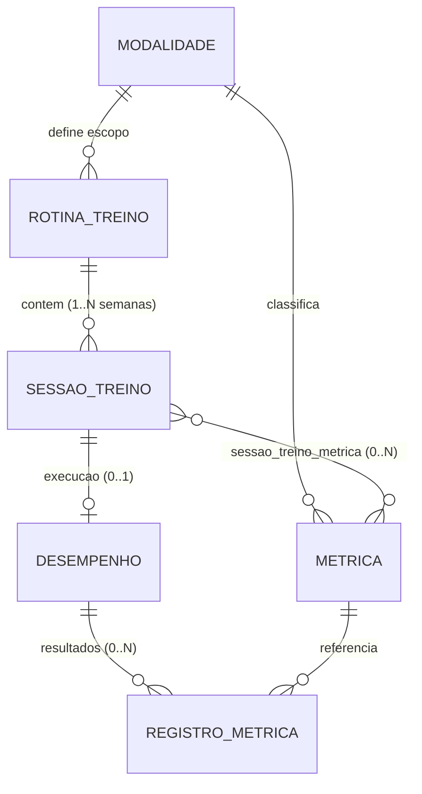
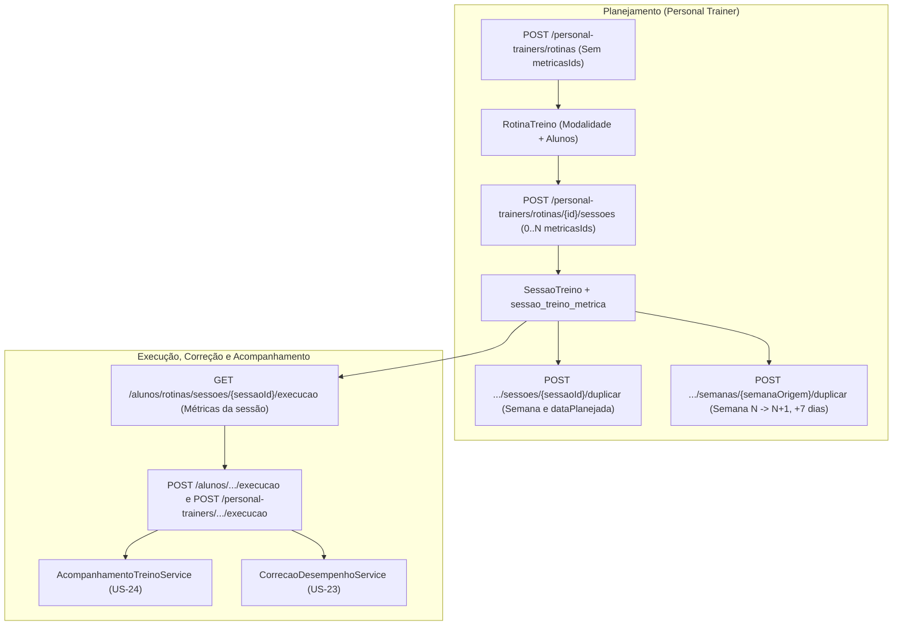

# Vínculo de Métricas Personalizadas por Sessão de Treino e Duplicação de Planejamento

*   **Author:** Equipe Gymnasion (`@regetz`)
*   **Status:** Implemented
*   **Date:** 2026-11-11
*   **Requisitos de Referência:** [Catálogo de Requisitos Gymnasion](../../.agent/skills/gymnasion-requirements/SKILL.md)

--------------------------------------------------------------------------------

## Overview

Na plataforma Gymnasion, o acompanhamento de desempenho esportivo baseia-se em métricas personalizadas (`Metrica`) criadas pelo Personal Trainer por modalidade esportiva (`Modalidade`). Atualmente, o vínculo dessas métricas ocorre no cabeçalho da rotina de treino (`RotinaTreino`, via tabela associativa `rotina_treino_metrica`), fazendo com que todas as sessões planejadas (`SessaoTreino`) dentro da rotina apresentem o mesmo conjunto de métricas para preenchimento.

Este documento especifica a transferência do vínculo de métricas personalizadas de `RotinaTreino` para `SessaoTreino` (cardinalidade `0..N` métricas por sessão, restritas à mesma `Modalidade` da rotina), a eliminação de `metricasIds` na criação e edição da rotina, a migração retroativa de dados via Flyway (`V22__move_metricas_from_rotina_to_sessao.sql`) com restauração de vínculos históricos, e a inclusão das operações de **Duplicar Sessão** e **Duplicar Semana (`N -> N+1`, somando `+7 dias` nas datas planejadas e expandindo a rotina automaticamente)** no planejador semanal.

--------------------------------------------------------------------------------

## The Problem

Durante testes de usabilidade com Personal Trainers e alunos, identificou-se que uma rotina semanal raramente avalia as mesmas variáveis físicas em todas as sessões:

1.  **Questionário inadequado para o aluno na execução do treino (**US-22**):** Em uma rotina de Musculação dividida entre membros inferiores e superiores (ou uma rotina de Corrida dividida entre tiros, rodagem regenerativa e longo), o vínculo na `RotinaTreino` força o endpoint de execução do aluno a exibir todas as métricas da rotina em todos os treinos. Ao finalizar um treino de inferiores, o aluno recebe campos obrigatórios de membros superiores sem relação com o treino executado, inserindo valores zerados ou incorretos para conseguir concluir a sessão.
2.  **Impossibilidade de sessões sem métricas quantitativas:** Treinos regenerativos, de mobilidade ou de adaptação exigem apenas confirmação de conclusão, duração e percepção subjetiva de esforço (RPE na Escala de Borg CR-10 de 1 a 10, **RN-018**), sem métricas adicionais. Hoje o sistema impede criar rotinas sem métricas cadastradas na modalidade e bloqueia o registro de execução pelo Personal Trainer caso a lista `resultados` esteja vazia.
3.  **Falsos positivos de pendências do Personal Trainer (**US-24**):** Como `AcompanhamentoTreinoService` compara as métricas globais da rotina com os registros de cada sessão, qualquer métrica atribuída ao Personal Trainer (`quemPreenche` igual a `PERSONAL` ou `AMBOS`) aplicável a um único dia da semana gera alerta de pendência em todas as demais sessões da rotina.
4.  **Esforço repetitivo no planejamento:** Configurar métricas sessão por sessão ao longo de várias semanas aumenta o trabalho manual de planejamento se não houver recursos de cópia rápida de sessões e semanas.

--------------------------------------------------------------------------------

## Goals

*   **Vincular `0..N` métricas por `SessaoTreino`:** Permitir que o Personal Trainer selecione métricas ativas da modalidade da rotina ao criar ou editar qualquer sessão com status `PLANEJADA` (`POST /personal-trainers/rotinas/{id}/sessoes` e `PUT /personal-trainers/rotinas/sessoes/{sessaoId}`).
*   **Simplificar a criação da `RotinaTreino`:** Remover `metricasIds` de `CriarRotinaTreinoRequestDTO`, `AtualizarRotinaTreinoRequestDTO` e da tela `NewRoutine.tsx`, permitindo criar rotinas mesmo quando a modalidade ainda não possui métricas cadastradas.
*   **Exibir no formulário de execução apenas as métricas da sessão (**US-22**, **US-13**):** Garantir que `GET /alunos/rotinas/sessoes/{sessaoId}/execucao`, `POST /alunos/rotinas/sessoes/{sessaoId}/execucao` e `POST /personal-trainers/rotinas/sessoes/{sessaoId}/execucao` operem exclusivamente sobre as métricas vinculadas à `SessaoTreino`, aceitando `resultados: []` quando não houver métricas obrigatórias pendentes para o ator (registrando `dataReal`, `duracao` e `nivelCansaco`).
*   **Duplicar Sessão e Duplicar Semana no planejamento (**US-10**):** Disponibilizar os endpoints de duplicação de sessão e de semana no back-end (`POST /personal-trainers/rotinas/sessoes/{sessaoId}/duplicar` e `POST /personal-trainers/rotinas/{id}/semanas/{semanaOrigem}/duplicar`) e os respectivos controles na interface de `RoutineSessionPlanner.tsx`, somando `+7 dias` na `dataPlanejada` e expandindo a rotina automaticamente para a Semana `N+1`.
*   **Hierarquia visual Macro vs. Micro para métricas nos cards:** Manter em `RotinaTreinoResponseDTO.metricas` um resumo derivado somente-leitura (união distinta das métricas ativas vinculadas às sessões da rotina) para que `Routines.tsx` e `ProfileRoutineCard.tsx` exibam o contador `` `X métricas` ``, até 3 pills visíveis + badge `+N` com tooltip completo (ou `"Apenas RPE e duração"` quando vazio), preservando a busca textual por métrica enquanto o detalhe diário permanece nos cards de cada `SessaoTreino`.
*   **Migração retroativa de dados em produção (`V22`):** Migrar via Flyway os vínculos de `rotina_treino_metrica` e `registro_metrica` para `sessao_treino_metrica` em todas as sessões existentes (`PLANEJADA` e `CONCLUIDA`), preservando histórico de usuários ativos em produção.
*   **Preservar evolução (**US-15**), relatórios PDF (**US-16**), correção (**US-23**), pendências (**US-24**) e reutilização (**US-25**):** Garantir que a exclusão lógica de métricas (**RN-017**) remova vínculos apenas de sessões `PLANEJADA` (mantendo intactas sessões `CONCLUIDA`), que a reutilização de rotinas copie as métricas ativas de cada sessão e que o dashboard de evolução do aluno agregue todas as métricas utilizadas nas sessões e registros históricos.

--------------------------------------------------------------------------------

## Non-Goals

*   **Alterar os tipos de dados de métricas (**RN-015**):** Não serão adicionados novos tipos além de Numérico, Tempo/Cronômetro, Frequência Cardíaca e Texto/Observação.
*   **Permitir métricas de múltiplas modalidades na mesma sessão:** Uma `SessaoTreino` continuará aceitando exclusivamente métricas pertencentes à mesma `Modalidade` definida na `RotinaTreino`.
*   **Criar um catálogo independente de modelos de sessão fora da rotina:** A cópia de treinos ocorrerá dentro da própria rotina (via **Duplicar Sessão** e **Duplicar Semana**) ou por **Reutilização de Rotina (**US-25**)**.
*   **Alterar o funcionamento do RPE (**RN-018**):** O nível de cansaço (Escala de Borg CR-10 de 1 a 10) permanece como atributo nativo do `Desempenho` da sessão, independente das métricas personalizadas.

--------------------------------------------------------------------------------

## Open Questions

### Questões em Aberto

*   Nenhuma questão em aberto pendente para o desenho da solução.

### Decisões Resolvidas

*   **Questão 1 — Comportamento de Duplicar Semana no limite da rotina:**
    *   *Pergunta:* Ao acionar `"Duplicar Semana N para Semana N+1"` quando `N` for a última semana configurada, o sistema deve expandir a rotina automaticamente para `N+1` ou exigir uma semana de destino vazia previamente criada?
    *   *Alternativas avaliadas:* (a) exigir criação prévia manual da semana de destino; (b) criar automaticamente a Semana `N+1` ao duplicar.
    *   *Decisão:* O sistema expande automaticamente a rotina para a Semana `N+1` no planejador e acrescenta as sessões clonadas nessa semana (caso `N+1` já possua sessões, as sessões clonadas são adicionadas preservando as existentes).
*   **Questão 2 — Exibição de métricas nos cards macro de resumo de rotina:**
    *   *Pergunta:* Com a remoção do vínculo direto em `RotinaTreino`, os cards de `Routines.tsx` e `ProfileRoutineCard.tsx` devem deixar de mostrar métricas ou exibir o resumo agregado das sessões?
    *   *Alternativas avaliadas:* (a) omitir métricas nos cards macro; (b) listar todas as métricas sem limite; (c) exibir resumo derivado truncado.
    *   *Decisão:* Manter resumo somente-leitura derivado das métricas ativas das sessões com formato uniforme em ambos os componentes: contador `` `X métricas` ``, até 3 pills visíveis + badge `+N` com tooltip completo (ou `"Apenas RPE e duração"` quando vazio), evitando aumento da altura das linhas da tabela e quebra de layout em rotinas com múltiplas divisões, ao mesmo tempo em que preserva o filtro textual por nome de métrica na listagem de rotinas.

--------------------------------------------------------------------------------

## Critical User Journeys (CUJs)

### CUJ 1: Planejamento de Rotina com Divisão de Treinos (Inferiores vs. Superiores) e Duplicação de Semana

*   **Given**: Um Personal Trainer autenticado que criou uma rotina ativa de "Musculação" para um aluno, possuindo no catálogo da modalidade as métricas "Carga Agachamento Livre (kg)", "Carga Leg Press (kg)", "Carga Supino Reto (kg)" e "Carga Remada Curvada (kg)".
*   **When**: Na tela de planejamento da rotina, na Semana 1, o Personal Trainer cria a Sessão 1 (Segunda-feira, `2026-11-16`) vinculando apenas as métricas de inferiores ("Carga Agachamento Livre" e "Carga Leg Press"), cria a Sessão 2 (Quarta-feira, `2026-11-18`) vinculando apenas as métricas de superiores ("Carga Supino Reto" e "Carga Remada Curvada"), cria a Sessão 3 (Sexta-feira, `2026-11-20`) de mobilidade com `0` métricas vinculadas, e aciona `"Duplicar Semana 1 -> Semana 2"`.
*   **Then**: O sistema cria automaticamente a Semana 2 com três novas sessões `PLANEJADA` nas datas `2026-11-23`, `2026-11-25` e `2026-11-27` (`+7 dias`), preservando em cada sessão suas atividades, duração e conjunto de métricas vinculadas (`2`, `2` e `0` métricas). Nos cards macro da rotina, o resumo derivado exibe `` `4 métricas` ``, até 3 pills visíveis e o badge `+1` com tooltip contendo a lista completa.

### CUJ 2: Execução de Sessão pelo Aluno com Questionário Específico do Dia (**US-22**)

*   **Given**: Um aluno autenticado com a rotina da CUJ 1 ativa, acessando a execução da Sessão 1 (Treino de Inferiores) e, posteriormente, da Sessão 3 (Treino de Mobilidade com `0` métricas).
*   **When**: O aluno abre o formulário da Sessão 1 (`GET /alunos/rotinas/sessoes/{sessaoId}/execucao`) e registra a conclusão (`POST /alunos/rotinas/sessoes/{sessaoId}/execucao`), repetindo o fluxo na Sessão 3.
*   **Then**: Na Sessão 1, o formulário exibe apenas "Carga Agachamento Livre (kg)" e "Carga Leg Press (kg)"; na Sessão 3, o formulário exibe somente data real, duração e RPE (Escala de Borg CR-10 de 1 a 10), permitindo concluir o treino sem resultados de métricas personalizadas e sem erro de validação.

### CUJ 3: Evolução de Desempenho (**US-15**) e Exclusão Lógica de Métrica (**RN-017**)

*   **Given**: Um aluno que executou 6 sessões na rotina (3 de Inferiores e 3 de Superiores) e um Personal Trainer que exclui do catálogo uma métrica que já possui registros nessas sessões concluídas e também está vinculada a sessões com status `PLANEJADA`.
*   **When**: O Personal Trainer executa `DELETE /personal-trainers/metricas/{id}` e consulta o perfil de evolução do aluno bem como os detalhes das sessões passadas e planejadas.
*   **Then**: A métrica sofre exclusão lógica (`ativo = false`), tem seu vínculo removido das sessões `PLANEJADA` (junto à ressincronização das notificações de pendência), permanece vinculada e visível nas sessões já `CONCLUIDA`, deixa de constar nos novos resumos macro da rotina ativa, e continua selecionável no dashboard de evolução (**US-15**) a partir do histórico registrado.

--------------------------------------------------------------------------------

## Technical Plan (Architecture)

### 1. Modelo de Dados e Migração Relacional (PostgreSQL + Flyway `V22`)

A alteração no banco de dados move a tabela associativa de configuração do cabeçalho da rotina para cada sessão de treino, mantendo íntegros os vínculos e os resultados históricos já registrados em `desempenho` e `registro_metrica`.

#### 1.1. Estratégia da Migration `V22__move_metricas_from_rotina_to_sessao.sql`

*   **Criação da tabela e índices:** Cria a tabela associativa `sessao_treino_metrica` com chave primária composta `(sessao_treino_id, metrica_id)`, referência `sessao_treino_id -> sessao_treino(id) ON DELETE CASCADE` e referência `metrica_id -> metrica(id) ON DELETE RESTRICT`, além dos índices `idx_stm_sessao` em `(sessao_treino_id)` e `idx_stm_metrica` em `(metrica_id)` para consultas de uso e remoção seletiva em sessões planejadas.
*   **Carga de dados em duas etapas (`ON CONFLICT DO NOTHING`):**
    *   **Etapa 1 (Vínculos de rotinas atuais):** Copia todos os pares `(st.id, rtm.metrica_id)` de `sessao_treino` em junção (`JOIN`) com `rotina_treino_metrica` para todas as sessões existentes (`PLANEJADA` e `CONCLUIDA`).
    *   **Etapa 2 (Restauração de vínculos históricos — **RN-017**):** Copia todos os pares `(d.sessao_treino_id, rm.metrica_id)` de `desempenho` em junção (`JOIN`) com `registro_metrica` para restaurar nas sessões `CONCLUIDA` eventuais métricas já preenchidas no passado que haviam sido descontinuadas e removidas de `rotina_treino_metrica`.
*   **Limpeza de esquema:** Remove a tabela `rotina_treino_metrica`.

### 2. Arquitetura de Domínio e Serviços (Back-end Spring Boot)

Os serviços de planejamento, execução, correção, acompanhamento e catálogo de métricas passam a consultar os vínculos diretamente em `SessaoTreino`, preservando contratos agregados somente-leitura onde a interface necessita de visão resumida da rotina.

#### 2.1. Entidades JPA e Estratégia de Consulta (`RotinaTreino` e `SessaoTreino`)

*   Em `RotinaTreino`, remove-se o relacionamento direto com `rotina_treino_metrica`. Para evitar consultas N+1 nas listagens paginadas (`listarMinhasRotinas`, `listarPorAluno`, `listarPorPersonal` e `buscarPorId`), `RotinaTreinoService` popula `RotinaTreinoResponseDTO.metricas` por meio de uma consulta agregada em lote por identificadores de rotina (`SELECT DISTINCT` das métricas ativas vinculadas às sessões das rotinas da página), sem carregar coleções completas de sessões em memória; o método auxiliar em memória em `RotinaTreino` atua apenas quando as sessões já foram carregadas.
*   Em `SessaoTreino`, adiciona-se o relacionamento muitos-para-muitos com `Metrica` via `sessao_treino_metrica`, com ordenação alfabética por `titulo` e estratégia de carregamento em lote (`JOIN FETCH` nas consultas de planejamento, execução e `reutilizarRotina`, e carregamento em lote na entidade).

#### 2.2. Contratos de API e DTOs

*   **Criação e atualização de rotina (`POST /personal-trainers/rotinas` e `PUT /personal-trainers/rotinas/{id}`):** Remove-se `metricasIds` de `CriarRotinaTreinoRequestDTO` e `AtualizarRotinaTreinoRequestDTO`. `RotinaTreinoService.criarRotinaTreino` deixa de exigir métrica pré-cadastrada na modalidade. `RotinaTreinoResponseDTO` mantém `metricas` preenchido em modo somente-leitura com a união distinta (ordenada por `titulo`) das métricas **ativas** (`ativo == true`) utilizadas nas sessões da rotina.
*   **Criação, edição e resposta de sessão (`POST /personal-trainers/rotinas/{id}/sessoes` e `PUT /personal-trainers/rotinas/sessoes/{sessaoId}`):**
    *   `CriarSessaoTreinoRequestDTO`: adiciona campo opcional `metricasIds`; valor `null` ou `[]` cria a sessão com `0` métricas. Exige `1 <= semana <= 104`.
    *   `AtualizarSessaoTreinoRequestDTO`: adiciona campo opcional `metricasIds`; `null` (campo omitido por chamadores parciais) preserva os vínculos existentes na sessão, enquanto lista vazia explícita (`[]`) desvincula todas as métricas (`0` métricas). Exige `rotina.ativo == true`, `1 <= semana <= 104` e aciona `acompanhamentoTreinoService.sincronizarNotificacaoParaAluno` para os alunos vinculados após alterar métricas.
    *   `RotinaTreinoService.validarMetricasDaModalidade`: para cada ID informado, valida pertencimento ao Personal Trainer autenticado (**RN-005**), mesma modalidade da rotina e `ativo == true` (**RN-017**).
    *   `SessaoTreinoResponseDTO`: adiciona `metricasIds` e `metricas` (preservando em sessões `CONCLUIDA` métricas históricas eventualmente descontinuadas).
*   **Acompanhamento e planejamento (`SessaoAcompanhamentoDTO` e `PlanejamentoRotinaResponseDTO`):**
    *   `SessaoAcompanhamentoDTO`: adiciona `metricasIds` e `metricas` no retorno de `AcompanhamentoTreinoService.montarSnapshotRotina` para que o perfil do aluno conheça as métricas específicas de cada sessão sem depender do resumo macro da rotina.
    *   `PlanejamentoRotinaResponseDTO`: passa a trafegar, dentro de cada semana em `semanas[].sessoes`, os campos `metricasIds` e `metricas` de cada `SessaoTreinoResponseDTO`.
*   **Duplicar Sessão (`POST /personal-trainers/rotinas/sessoes/{sessaoId}/duplicar`):**
    *   Recebe `DuplicarSessaoTreinoRequestDTO(Integer semana, LocalDate dataPlanejada)` com `1 <= semana <= 104`.
    *   Valida que `sessaoOrigem` pertence a uma rotina ativa do Personal Trainer autenticado, cria nova `SessaoTreino` com `status = PLANEJADA`, copia `duracao`, `atividades` e métricas ativas (`ativo == true`) de `sessaoOrigem`, aciona `acompanhamentoTreinoService.sincronizarNotificacaoParaAluno` para os alunos vinculados e retorna `201 Created` com `SessaoTreinoResponseDTO`.
*   **Duplicar Semana (`POST /personal-trainers/rotinas/{id}/semanas/{semanaOrigem}/duplicar`):**
    *   Recebe `id` da rotina e `semanaOrigem` (`1 <= semanaOrigem <= 103`), validando `rotina.ativo == true`. Duplica exclusivamente para a semana seguinte (`semanaDestino = semanaOrigem + 1`).
    *   Busca sessões de `semanaOrigem` ordenadas por `dataPlanejada ASC`. Se a semana estiver vazia, retorna erro de regra de negócio (`"A semana selecionada não possui sessões para duplicar."`).
    *   Caso `semanaOrigem + 1` já contenha sessões, mantém as sessões existentes e acrescenta as novas sessões clonadas (comportamento aditivo). Cada sessão clonada recebe `semana = semanaOrigem + 1`, `dataPlanejada` somada em `+7 dias`, `status = PLANEJADA`, `duracao`, `atividades` e métricas ativas (`ativo == true`). Sincroniza notificações via `acompanhamentoTreinoService.sincronizarNotificacaoParaAluno` e retorna `201 Created` com `PlanejamentoRotinaResponseDTO` atualizado (incluindo a Semana `N+1` em `semanas`).

#### 2.3. Execução (**US-22**, **US-13**), Correção (**US-23**), Pendências (**US-24**), Reutilização (**US-25**), PDF/Strava (**US-16**) e Ciclo de Vida de Métrica (**RN-017**)

*   **Execução (`RotinaTreinoService.obterFormularioExecucao` e `registrarExecucao`):**
    *   Endpoints cobertos: `GET /alunos/rotinas/sessoes/{sessaoId}/execucao`, `POST /alunos/rotinas/sessoes/{sessaoId}/execucao` e `POST /personal-trainers/rotinas/sessoes/{sessaoId}/execucao`.
    *   Lê as métricas diretamente de `sessao.getMetricas()` em lugar da rotina.
    *   Na conclusão inicial (`!somenteInclusaoPendentes`), registra `dataReal`, `duracao` e `nivelCansaco` (RPE) e aceita `resultados: []` quando a sessão não possui métricas ativas obrigatórias pendentes para o ator (`ALUNO`: `obrigatoria == true` e `quemPreenche` igual a `ALUNO` ou `AMBOS`; `PERSONAL_TRAINER`: `obrigatoria == true` e `quemPreenche` igual a `PERSONAL` ou `AMBOS`). Quando o Personal Trainer registra apenas inclusão de pendentes em sessão já executada (`somenteInclusaoPendentes == true`), `resultados: []` continua rejeitado com `BusinessException` para evitar operação sem efeito.
*   **Correção de Desempenho (`CorrecaoDesempenhoService`):** Substitui a leitura de métricas da rotina pelas métricas de `sessao` nos métodos de consulta e validação de correção, permitindo corrigir `dataReal` e `observacaoCorrecao` em sessões concluídas com `0` métricas vinculadas.
*   **Acompanhamento e Pendências (`AcompanhamentoTreinoService`):** Em `extrairPendenciasSessao`, compara os registros de desempenho apenas com as métricas vinculadas à própria sessão (`sessao`), eliminando pendências falsas entre dias distintos de treino, e preenche `metricas`/`metricasIds` em `SessaoAcompanhamentoDTO`.
*   **Reutilização de Rotina (**US-25**):** Em `reutilizarRotinaInterno`, copia para cada sessão clonada apenas as métricas ativas da respectiva sessão de origem (substituindo a cópia antiga a partir de `rotinaOrigem`), utilizando consulta com fetch das sessões e métricas para evitar N+1.
*   **Relatórios PDF (**US-16**) e Integração Strava (`campoStrava`):** `RelatorioPerformanceService` consulta diretamente `desempenho` e `registro_metrica` (preservados intactos pela `V22`), sem qualquer dependência de `rotina_treino_metrica`; a atribuição de campos Strava (`campoStrava`) no registro de execução e no formulário do modal passa a ler os atributos das métricas vinculadas à sessão.
*   **Ciclo de Vida e Exclusão de Métrica (`MetricaService` — **RN-017**):**
    *   Tanto `MetricaService.atualizarMetrica` quanto `MetricaService.excluirMetrica` substituem a verificação na rotina por consultas em `SessaoTreinoRepository`.
    *   Na exclusão (`excluirMetrica`), `possuiHistorico` considera registros em `registro_metrica`, `auditoria_desempenho` ou vínculo em sessões `CONCLUIDA`. Antes da exclusão física (quando não há histórico executado) ou durante a exclusão lógica (`ativo = false`), o serviço remove primeiro os vínculos da métrica em sessões com `status = 'PLANEJADA'` (`removerMetricaDeSessoesPlanejadas`), prevenindo violação de `ON DELETE RESTRICT` em `sessao_treino_metrica`, preserva intactas sessões `CONCLUIDA` e aciona `acompanhamentoTreinoService.sincronizarNotificacaoParaAluno` para os alunos das rotinas impactadas.

### 3. Arquitetura de Interfaces e Fluxos de Usuário (Front-end Web)

As telas de criação, planejamento semanal, listagem macro, registro de execução e perfil evolutivo adaptam-se para editar métricas por sessão e ler exclusivamente métricas vinculadas à sessão selecionada.

#### 3.1. Cadastro de Rotina (`NewRoutine.tsx` e `routineModel.ts`)

*   Remove o bloco `"Card 2 · Métricas acompanhadas"` e a obrigatoriedade de `metricasIds` em `routineModel.ts`. O formulário de criação solicita apenas Título, Modalidade, Frequência Semanal, Objetivos e Alunos/Turma, redirecionando após salvar para o planejamento semanal.
*   Quando aberta a rota de variação por modelo (`?modelo={id}`), `applyRoutineAsModel` pré-preenche apenas os metadados da rotina (`titulo`, `modalidadeId`, `frequenciaSemanal` e `objetivos`), sem pré-selecionar métricas; a clonagem completa com sessões e suas métricas segue disponível pela ação de **Reutilização de Rotina (**US-25**)**.

#### 3.2. Planejador de Sessões Semanais (`RoutineSessionPlanner.tsx`)

*   Carrega métricas ativas da modalidade ao abrir o planejador (`metricaService.listarPorModalidade`) e mantém botão inline `+ Nova métrica`.
*   Remove o card estático `"Métricas desta rotina · registradas em cada sessão"` para eliminar a ambiguidade de configuração global.
*   No formulário de criação de sessão, adiciona seletor `0..N` com pills selecionáveis, filtro textual por nome e atalhos (*Selecionar obrigatórias*, *Selecionar todas*, *Limpar — 0 métricas*); ao acionar *"Usar como base"* em uma sessão existente, copia apenas as métricas ativas (`ativo == true`) dessa sessão para o formulário.
*   Nos cards de cada sessão da semana, renderiza as pills das métricas vinculadas à sessão ou `"Apenas RPE e duração"` quando `0` métricas.
*   **Ações de Duplicação:**
    *   No cabeçalho da Semana `N`: botão `"Duplicar Semana N -> Semana N+1"` (desabilitado enquanto a requisição está em curso para evitar duplicação acidental por duplo clique), que invoca `rotinaService.duplicarSemana`, expande automaticamente o total de semanas se estiver na última semana, atualiza o estado com o `PlanejamentoRotinaResponseDTO` retornado e ativa a aba `N+1`.
    *   Em cada card de sessão: botão `"Duplicar sessão"`, que abre diálogo com seleção da semana de destino (`1..104` ou `+ Nova Semana`) e campo `dataPlanejada` sugerido automaticamente com deslocamento proporcional (`+7 * (semanaDestino - semanaOrigem)` dias) para preservar a ordenação cronológica entre semanas (**US-21**).

#### 3.3. Cards Macro de Rotina e Busca Textual (`Routines.tsx`, `routineModel.ts` e `ProfileRoutineCard.tsx`)

*   Consomem o campo derivado somente-leitura `routine.metricas` exibindo formato padronizado em ambos `Routines.tsx` e `ProfileRoutineCard.tsx`: contador `` `X métricas` ``, até 3 pills visíveis + badge `+N` com tooltip listando todas as métricas (ou `"Apenas RPE e duração"` quando `0` métricas).
*   Em `routineModel.ts`, `visibleRoutines` passa a incluir o campo `routine.metricas[].titulo` no filtro textual de busca da página de rotinas.

#### 3.4. Execução, Edição Futura, Registro pelo Personal e Correção (`StudentRpeModal.tsx`, `SessionRegisterDialog.tsx`, `StudentSessionEdit.tsx`, `StudentSessionDetail.tsx`)

*   `StudentRpeModal.tsx` e `studentAreaModel.ts`: consomem as métricas da sessão vindas do formulário de execução (`0..N`) e permitem submissão com `resultados: []` em sessões sem métricas obrigatórias pendentes.
*   `SessionRegisterDialog.tsx`: substitui a leitura de `currentRoutine.metricas` pelas métricas da sessão selecionada em `candidates`, mantendo o autopreenchimento Strava (`campoStrava`) sobre essas métricas e permitindo ao Personal Trainer concluir sessões com `0` métricas informando data real, duração e RPE (removendo o bloqueio anterior de `"rotina sem métricas para o personal"`).
*   `StudentSessionEdit.tsx`: em sessões com status `PLANEJADA`, carrega métricas da modalidade e permite editar `metricasIds` da sessão; em sessões `CONCLUIDA` (correção **US-23**), permite salvar alterações de `dataReal` e `observacaoCorrecao` mesmo com `0` métricas.
*   `StudentSessionDetail.tsx`: passa a ler `sessaoData.metricas` em vez de `rotinaInfo.metricas`.

#### 3.5. Perfil e Dashboard de Evolução do Aluno (`StudentProfile.tsx` e `profileModel.ts`)

*   Em `profileModel.ts`, `buildActiveRoutineSessions` passa a transportar `metricas` e `metricasIds` recebidos de `SessaoAcompanhamentoDTO`, e `buildTrackingFromPlanning` apura as pendências do Personal Trainer comparando os registros de `desempenho` contra `s.metricas` de cada sessão planejada (em vez de `routine.metricas`).
*   O cálculo de `allMetrics` em `StudentProfile.tsx` passa a gerar a união distinta das métricas presentes nas sessões da rotina ativa, no resumo derivado das rotinas e no histórico de `desempenho` concluídos.

--------------------------------------------------------------------------------

## Alternatives Considered

### Alternative A: Manter Vínculo na `RotinaTreino` e Tornar Todas as Métricas Opcionais

*   **Pros**: Nenhuma alteração de esquema relacional (`rotina_treino_metrica`) e menor volume de mudanças em `RotinaTreinoService`.
*   **Cons**: O formulário do aluno (`GET /alunos/rotinas/sessoes/{sessaoId}/execucao`) continuaria listando todas as métricas da rotina em todas as sessões. Em um treino de membros inferiores, o aluno continuaria visualizando métricas de membros superiores, e métricas obrigatórias específicas do dia deixariam de ser exigidas pelo back-end.
*   **Reason for Rejection**: Não impede a exibição de campos sem relação com o treino executado e mantém falsos positivos nas pendências do Personal Trainer (**US-24**).

### Alternative B: Modelo Híbrido com Herança Automática das Métricas da Rotina para Toda Nova Sessão

*   **Pros**: Permite definir um conjunto padrão na criação da rotina e sobrescrever na sessão quando necessário.
*   **Cons**: Mantém duas fontes de verdade (`rotina_treino_metrica` e `sessao_treino_metrica`). Além disso, se a rotina possuir métricas de Superiores e Inferiores cadastradas como padrão, toda nova sessão herdará ambas por padrão, fazendo com que qualquer esquecimento do Personal Trainer ao desmarcar métricas reapresente o questionário errado ao aluno.
*   **Reason for Rejection**: Como `RotinaTreino` já possui `modalidadeId` obrigatório, o catálogo filtrado por modalidade já disponibiliza a seleção direta em cada sessão, enquanto **Duplicar Sessão** e **Duplicar Semana** reduzem o trabalho repetitivo sem exibir métricas indevidas entre dias de treino diferentes.

### Alternative C: Migrar na `V22` Apenas Sessões `CONCLUIDA` e Esvaziar Sessões `PLANEJADA`

*   **Pros**: Remove de imediato o conjunto completo de métricas da rotina das próximas sessões planejadas em produção.
*   **Cons**: Como produção já possui rotinas e sessões `PLANEJADA` em andamento de usuários ativos, remover todos os vínculos durante o deploy faria os próximos treinos aparecerem com `0` métricas sem prévia ação ou aviso ao Personal Trainer.
*   **Reason for Rejection**: Altera de forma inesperada planejamentos ativos em andamento. A estratégia escolhida copia os vínculos atuais para todas as sessões existentes (`PLANEJADA` e `CONCLUIDA`) e permite ao Personal Trainer ajustar individualmente suas sessões planejadas.

--------------------------------------------------------------------------------

## Non-Functional Requirements

*   **Isolamento Multi-Tenant e Segurança (**RN-005**, **RN-006**):** Todas as operações de criação, edição e duplicação de sessão ou semana validam no back-end que `RotinaTreino`, `SessaoTreino` e cada `Metrica` vinculada pertencem ao `PersonalTrainer` autenticado.
*   **Desempenho e Orçamento de Consultas SQL (**RNF-001**):** O carregamento de sessões de uma rotina no planejamento/execução e o cálculo do resumo de métricas nas listagens paginadas de rotinas devem ocorrer em número limitado de consultas SQL (evitando consultas N+1 e produtos cartesianos em paginação).
*   **Integridade de Auditoria e Histórico (**RN-015**, **RN-017**, **US-23**):** A migração `V22` e a exclusão lógica de métricas preservam todos os vínculos históricos em sessões `CONCLUIDA`, `registro_metrica` e `auditoria_desempenho`.

--------------------------------------------------------------------------------

## Risks & Mitigations

*   **Risco 1 — Remoção destrutiva de `rotina_treino_metrica` na `V22` (rotinas com 0 sessões e rollback):**
    *   *Modo de falha:* Rotinas já criadas em produção que ainda possuam `0` sessões em `sessao_treino` perderão o antigo vínculo de métricas; além disso, `DROP TABLE rotina_treino_metrica` inviabiliza rollback apenas do binário da aplicação sem restauração de backup de banco.
    *   *Mitigação:* Executar backup/snapshot do banco antes do deploy da `V22`, rodar consulta prévia verificando eventuais rotinas com `0` sessões em produção e aplicar deploy coordenado em janela programada. Caso seja exigido rollback sem restore em deploys futuros, adiar `DROP TABLE rotina_treino_metrica` para uma migration de limpeza subsequente (`V23`).
*   **Risco 2 — Compatibilidade de clientes em cache ou aplicativo mobile durante rollout:**
    *   *Modo de falha:* Um cliente legado que envie `PUT /personal-trainers/rotinas/sessoes/{sessaoId}` omitindo `metricasIds` poderia zerar vínculos da sessão, ou enviar `metricasIds` em `POST /personal-trainers/rotinas` e gerar rotinas com `0` métricas sem erro porque o desserializador ignora campos desconhecidos.
    *   *Mitigação:* Tratar `metricasIds == null` em `AtualizarSessaoTreinoRequestDTO` como preservação dos vínculos atuais (exigindo `[]` explícito para zerar) e coordenar a implantação simultânea de back-end e front-end web (alinhando previamente o contrato antes de liberar novos builds mobile).
*   **Risco 3 — Concorrência entre edição pelo Personal Trainer e execução pelo Aluno:**
    *   *Modo de falha:* O aluno abre `GET .../execucao` antes de o Personal Trainer editar `metricasIds` ou excluir uma métrica, submetendo respostas para métricas desvinculadas.
    *   *Mitigação:* `registrarExecucao` sempre revalida no servidor contra o conjunto persistido atual em `sessao.getMetricas()` retornando `422 Unprocessable Entity` com mensagem clara em caso de divergência, enquanto exclusões lógicas preservam métricas já preenchidas em `Desempenho`.
*   **Risco 4 — Escala em rotinas longas e múltiplos alunos por sessão/turma:**
    *   *Modo de falha:* Duplicação repetida de semanas ou rotinas paginadas com dezenas de sessões e métricas poderiam degradar latência ou gerar inconsistência de notificações.
    *   *Mitigação:* Impor limite superior `1 <= semana <= 104`, usar consultas agregadas em lote por `rotinaIds` nas listagens de rotinas e fetch explícito no planejamento e clonagem (`reutilizarRotina`), além de ressincronizar notificações (`sincronizarNotificacaoParaAluno`) de forma transacional ao alterar vínculos em massa.

--------------------------------------------------------------------------------

## Detailed Implementation Plan

### Target Files to Create/Modify

#### 1. [`/Users/regetz/Documents/tcc/src/main/resources/db/migration/V22__move_metricas_from_rotina_to_sessao.sql`](file:///Users/regetz/Documents/tcc/src/main/resources/db/migration/V22__move_metricas_from_rotina_to_sessao.sql) (Create)

*   **Type / Scope**: Script de Migração SQL (Flyway / PostgreSQL)
*   **Proposed Changes**: Criar a tabela `sessao_treino_metrica (sessao_treino_id, metrica_id)` com índices `idx_stm_sessao` e `idx_stm_metrica`; popular com todos os pares de `sessao_treino` juntada com `rotina_treino_metrica` (`ON CONFLICT DO NOTHING`) e com os pares de `desempenho` juntada com `registro_metrica` para blindar histórico de métricas descontinuadas (RN-017); remover a tabela `rotina_treino_metrica`.

#### 2. [`/Users/regetz/Documents/tcc/src/main/java/com/gymnasion/tcc/domain/RotinaTreino.java`](file:///Users/regetz/Documents/tcc/src/main/java/com/gymnasion/tcc/domain/RotinaTreino.java) (Modify)

*   **Type / Scope**: Entidade JPA (Domínio Back-end)
*   **Proposed Changes**: Remover o atributo `@ManyToMany Set<Metrica> metricas` mapeado para `rotina_treino_metrica` e adicionar método utilitário `getMetricasUtilizadasNasSessoes()` que extrai de `this.sessoes` o conjunto distinto de métricas ordenadas por `titulo`, necessário para alimentar o resumo macro de leitura em `RotinaTreinoResponseDTO`.

#### 3. [`/Users/regetz/Documents/tcc/src/main/java/com/gymnasion/tcc/domain/SessaoTreino.java`](file:///Users/regetz/Documents/tcc/src/main/java/com/gymnasion/tcc/domain/SessaoTreino.java) (Modify)

*   **Type / Scope**: Entidade JPA (Domínio Back-end)
*   **Proposed Changes**: Adicionar o relacionamento `@ManyToMany` com `Metrica` via tabela `sessao_treino_metrica`, anotado com `@OrderBy("titulo ASC")` e `@BatchSize(size = 50)`, permitindo que cada sessão possua de `0` a `N` métricas personalizadas.

#### 4. [`/Users/regetz/Documents/tcc/src/main/java/com/gymnasion/tcc/repository/RotinaTreinoRepository.java`](file:///Users/regetz/Documents/tcc/src/main/java/com/gymnasion/tcc/repository/RotinaTreinoRepository.java) (Modify)

*   **Type / Scope**: Repositório Spring Data JPA (Back-end)
*   **Proposed Changes**: Remover os métodos que referenciavam `r.metricas` ou `rotina_treino_metrica` (`existsByMetricaId` e queries de remoção na tabela antiga), evitando erro de inicialização do contexto JPA.

#### 5. [`/Users/regetz/Documents/tcc/src/main/java/com/gymnasion/tcc/repository/SessaoTreinoRepository.java`](file:///Users/regetz/Documents/tcc/src/main/java/com/gymnasion/tcc/repository/SessaoTreinoRepository.java) (Modify)

*   **Type / Scope**: Repositório Spring Data JPA (Back-end)
*   **Proposed Changes**: Adicionar `existsByMetricaId(UUID metricaId)` consultando `SessaoTreino s JOIN s.metricas m`, adicionar `removerMetricaDeSessoesPlanejadas(UUID metricaId)` que remove vínculos em `sessao_treino_metrica` exclusivamente onde `sessao_treino.status = 'PLANEJADA'`, adicionar busca por `rotinaTreinoId` e `semana` ordenada por `dataPlanejada ASC` para suportar a duplicação de semana, e incluir `LEFT JOIN FETCH s.metricas` nas consultas de planejamento e execução.

#### 6. [`/Users/regetz/Documents/tcc/src/main/java/com/gymnasion/tcc/repository/MetricaRepository.java`](file:///Users/regetz/Documents/tcc/src/main/java/com/gymnasion/tcc/repository/MetricaRepository.java) (Modify)

*   **Type / Scope**: Repositório Spring Data JPA (Back-end)
*   **Proposed Changes**: Atualizar a consulta de contagem de uso das métricas (`listarComContagemDeUso` / verificação de vínculo) para fazer `LEFT JOIN sessao_treino_metrica stm` e `LEFT JOIN sessao_treino st`, mantendo a contagem de rotinas/sessões que utilizam cada métrica.

#### 7. [`/Users/regetz/Documents/tcc/src/main/java/com/gymnasion/tcc/service/MetricaService.java`](file:///Users/regetz/Documents/tcc/src/main/java/com/gymnasion/tcc/service/MetricaService.java) (Modify)

*   **Type / Scope**: Serviço de Negócio (Back-end — US-18 / US-19 / RN-017)
*   **Proposed Changes**: Substituir `rotinaTreinoRepository.existsByMetricaId` por `sessaoTreinoRepository.existsByMetricaId` na verificação `possuiHistorico` e, na exclusão lógica de métrica com histórico, invocar `sessaoTreinoRepository.removerMetricaDeSessoesPlanejadas(id)` para desacoplar apenas sessões futuras (`PLANEJADA`), preservando sessões `CONCLUIDA`.

#### 8. [`/Users/regetz/Documents/tcc/src/main/java/com/gymnasion/tcc/dto/CriarRotinaTreinoRequestDTO.java`](file:///Users/regetz/Documents/tcc/src/main/java/com/gymnasion/tcc/dto/CriarRotinaTreinoRequestDTO.java) (Modify)

*   **Type / Scope**: DTO de Requisição (Back-end)
*   **Proposed Changes**: Remover o campo `Set<UUID> metricasIds` e sua anotação `@NotEmpty`, pois a criação de rotina não recebe mais métricas no cabeçalho.

#### 9. [`/Users/regetz/Documents/tcc/src/main/java/com/gymnasion/tcc/dto/AtualizarRotinaTreinoRequestDTO.java`](file:///Users/regetz/Documents/tcc/src/main/java/com/gymnasion/tcc/dto/AtualizarRotinaTreinoRequestDTO.java) (Modify)

*   **Type / Scope**: DTO de Requisição (Back-end)
*   **Proposed Changes**: Remover o campo `Set<UUID> metricasIds` da atualização de cabeçalho da rotina.

#### 10. [`/Users/regetz/Documents/tcc/src/main/java/com/gymnasion/tcc/dto/CriarSessaoTreinoRequestDTO.java`](file:///Users/regetz/Documents/tcc/src/main/java/com/gymnasion/tcc/dto/CriarSessaoTreinoRequestDTO.java) (Modify)

*   **Type / Scope**: DTO de Requisição (Back-end)
*   **Proposed Changes**: Adicionar o campo opcional `Set<UUID> metricasIds` para permitir vincular de `0` a `N` métricas na criação da sessão.

#### 11. [`/Users/regetz/Documents/tcc/src/main/java/com/gymnasion/tcc/dto/AtualizarSessaoTreinoRequestDTO.java`](file:///Users/regetz/Documents/tcc/src/main/java/com/gymnasion/tcc/dto/AtualizarSessaoTreinoRequestDTO.java) (Modify)

*   **Type / Scope**: DTO de Requisição (Back-end)
*   **Proposed Changes**: Adicionar o campo opcional `Set<UUID> metricasIds` para atualizar as métricas vinculadas a uma sessão futura (`PLANEJADA`).

#### 12. [`/Users/regetz/Documents/tcc/src/main/java/com/gymnasion/tcc/dto/DuplicarSessaoTreinoRequestDTO.java`](file:///Users/regetz/Documents/tcc/src/main/java/com/gymnasion/tcc/dto/DuplicarSessaoTreinoRequestDTO.java) (Create)

*   **Type / Scope**: DTO de Requisição (Back-end)
*   **Proposed Changes**: Definir record com `@NotNull @Min(1) Integer semana` e `@NotNull LocalDate dataPlanejada` para o endpoint de duplicação de sessão avulsa.

#### 13. [`/Users/regetz/Documents/tcc/src/main/java/com/gymnasion/tcc/dto/SessaoTreinoResponseDTO.java`](file:///Users/regetz/Documents/tcc/src/main/java/com/gymnasion/tcc/dto/SessaoTreinoResponseDTO.java) (Modify)

*   **Type / Scope**: DTO de Resposta (Back-end)
*   **Proposed Changes**: Incluir `List<UUID> metricasIds` e `List<RotinaTreinoResponseDTO.MetricaResumoDTO> metricas` para que o planejador semanal e os detalhes da sessão recebam as métricas vinculadas a cada sessão.

#### 14. [`/Users/regetz/Documents/tcc/src/main/java/com/gymnasion/tcc/dto/SessaoAcompanhamentoDTO.java`](file:///Users/regetz/Documents/tcc/src/main/java/com/gymnasion/tcc/dto/SessaoAcompanhamentoDTO.java) (Modify)

*   **Type / Scope**: DTO de Resposta de Acompanhamento (Back-end — US-24)
*   **Proposed Changes**: Adicionar `List<RotinaTreinoResponseDTO.MetricaResumoDTO> metricas` para que a tela de perfil e acompanhamento do aluno (`StudentProfile.tsx`) conheça as métricas planejadas de cada sessão.

#### 15. [`/Users/regetz/Documents/tcc/src/main/java/com/gymnasion/tcc/controller/RotinaTreinoController.java`](file:///Users/regetz/Documents/tcc/src/main/java/com/gymnasion/tcc/controller/RotinaTreinoController.java) (Modify)

*   **Type / Scope**: Controller REST (Back-end)
*   **Proposed Changes**: Adicionar os endpoints `POST /personal-trainers/rotinas/sessoes/{sessaoId}/duplicar` (recebendo `DuplicarSessaoTreinoRequestDTO` e retornando `201 Created` com `SessaoTreinoResponseDTO`) e `POST /personal-trainers/rotinas/{id}/semanas/{semanaOrigem}/duplicar` (retornando `201 Created` com `PlanejamentoRotinaResponseDTO`).

#### 16. [`/Users/regetz/Documents/tcc/src/main/java/com/gymnasion/tcc/service/RotinaTreinoService.java`](file:///Users/regetz/Documents/tcc/src/main/java/com/gymnasion/tcc/service/RotinaTreinoService.java) (Modify)

*   **Type / Scope**: Serviço de Negócio Principal (Back-end — US-09, US-10, US-13, US-22, US-25)
*   **Proposed Changes**:
    *   Em `criarRotinaTreino` e `atualizarRotina`: remover a validação de `metricasIds` na rotina e o bloqueio de modalidade sem métricas cadastradas.
    *   Em `adicionarSessao` e `editarSessaoFutura`: validar `dto.metricasIds()` (`0..N` métricas do personal, ativas e da mesma modalidade da rotina) e gravar em `sessao.setMetricas(...)`.
    *   Implementar `duplicarSessao(Usuario usuario, UUID sessaoId, DuplicarSessaoTreinoRequestDTO dto)` e `duplicarSemana(Usuario usuario, UUID rotinaId, Integer semanaOrigem)` (copiando sessões para `semanaOrigem + 1` com `dataPlanejada.plusDays(7)` e métricas ativas).
    *   Em `reutilizarRotina` (US-25): copiar as métricas ativas de cada `sessaoOrigem` para a nova sessão clonada.
    *   Em `obterFormularioExecucao` e `registrarExecucao`: ler `sessao.getMetricas()` em vez de `sessao.getRotinaTreino().getMetricas()`, e permitir que tanto o aluno quanto o personal registrem a execução com `resultados` vazio quando a sessão não possuir métricas obrigatórias pendentes.
    *   Em `toResponseDTO(RotinaTreino)`: popular `metricas` com `rotina.getMetricasUtilizadasNasSessoes()`.

#### 17. [`/Users/regetz/Documents/tcc/src/main/java/com/gymnasion/tcc/service/CorrecaoDesempenhoService.java`](file:///Users/regetz/Documents/tcc/src/main/java/com/gymnasion/tcc/service/CorrecaoDesempenhoService.java) (Modify)

*   **Type / Scope**: Serviço de Negócio (Back-end — US-23)
*   **Proposed Changes**: Substituir `sessao.getRotinaTreino().getMetricas()` por `sessao.getMetricas()` na leitura de detalhes para edição (`L60`) e na validação de correção (`L244`), permitindo salvar correção de `dataReal` e `observacaoCorrecao` em sessões sem métricas personalizadas.

#### 18. [`/Users/regetz/Documents/tcc/src/main/java/com/gymnasion/tcc/service/AcompanhamentoTreinoService.java`](file:///Users/regetz/Documents/tcc/src/main/java/com/gymnasion/tcc/service/AcompanhamentoTreinoService.java) (Modify)

*   **Type / Scope**: Serviço de Negócio (Back-end — US-24)
*   **Proposed Changes**: Em `extrairPendenciasSessao` (`L318`), inspecionar `sessao.getMetricas()` em vez de `sessao.getRotinaTreino().getMetricas()`, eliminando falsos positivos de pendência em sessões de outros grupamentos musculares, e preencher `metricas` em `SessaoAcompanhamentoDTO`.

#### 19. [`/Users/regetz/Documents/Projetos/Gymnasion_web/src/types/rotina.ts`](file:///Users/regetz/Documents/Projetos/Gymnasion_web/src/types/rotina.ts) e [`/Users/regetz/Documents/Projetos/Gymnasion_web/src/types/sessionDetail.ts`](file:///Users/regetz/Documents/Projetos/Gymnasion_web/src/types/sessionDetail.ts) (Modify)

*   **Type / Scope**: Contratos TypeScript (Front-end)
*   **Proposed Changes**: Remover `metricasIds` de `CriarRotinaPayload` e `AtualizarRotinaPayload`; adicionar `metricasIds?: string[]` em `CriarSessaoPayload`, `AtualizarSessaoPayload` e `EditarSessaoFuturaRequest`; adicionar `metricasIds: string[]` e `metricas: MetricaResumo[]` em `SessaoPlanejada` e `SessaoAcompanhamento`; adicionar `DuplicarSessaoPayload`.

#### 20. [`/Users/regetz/Documents/Projetos/Gymnasion_web/src/services/rotinaService.ts`](file:///Users/regetz/Documents/Projetos/Gymnasion_web/src/services/rotinaService.ts) (Modify)

*   **Type / Scope**: Cliente HTTP de API (Front-end)
*   **Proposed Changes**: Adicionar os métodos `duplicarSessao(sessaoId: string, payload: DuplicarSessaoPayload)` (`POST /personal-trainers/rotinas/sessoes/${sessaoId}/duplicar`) e `duplicarSemana(rotinaId: string, semanaOrigem: number)` (`POST /personal-trainers/rotinas/${rotinaId}/semanas/${semanaOrigem}/duplicar`).

#### 21. [`/Users/regetz/Documents/Projetos/Gymnasion_web/src/features/routines/routineModel.ts`](file:///Users/regetz/Documents/Projetos/Gymnasion_web/src/features/routines/routineModel.ts) e [`/Users/regetz/Documents/Projetos/Gymnasion_web/src/pages/Routines/NewRoutine.tsx`](file:///Users/regetz/Documents/Projetos/Gymnasion_web/src/pages/Routines/NewRoutine.tsx) (Modify)

*   **Type / Scope**: Modelo de Validação e Página de Criação de Rotina (Front-end)
*   **Proposed Changes**: Remover a validação de obrigatoriedade de `metricasIds` na criação de rotina em `routineModel.ts` e remover o "Card 2 · Métricas acompanhadas" de `NewRoutine.tsx`, simplificando o cadastro inicial da rotina para Dados Básicos + Alunos/Turma.

#### 22. [`/Users/regetz/Documents/Projetos/Gymnasion_web/src/pages/RoutineSessionPlanner/RoutineSessionPlanner.tsx`](file:///Users/regetz/Documents/Projetos/Gymnasion_web/src/pages/RoutineSessionPlanner/RoutineSessionPlanner.tsx) e [`RoutineSessionPlanner.css`](file:///Users/regetz/Documents/Projetos/Gymnasion_web/src/pages/RoutineSessionPlanner/RoutineSessionPlanner.css) (Modify)

*   **Type / Scope**: Planejador de Sessões Semanais (Front-end — US-10)
*   **Proposed Changes**:
    *   Carregar métricas ativas da modalidade (`metricaService.listarPorModalidade`) e oferecer botão `+ Nova métrica` inline.
    *   Adicionar seletor de `0..N` métricas no formulário de "Nova sessão" (com atalhos *Todas*, *Obrigatórias*, *Limpar* e cópia das métricas ao clicar em *"Usar como base"*).
    *   Renderizar os chips das métricas vinculadas em cada card de sessão (`week-session-card`) ou `"Apenas RPE e duração"` quando vazio.
    *   Adicionar o botão `"Duplicar Semana N → Semana N+1"` no cabeçalho da semana (com auto-expansão de `totalWeeks` e troca automática para a nova aba `N+1`) e o botão `"Duplicar sessão"` em cada card de sessão.

#### 23. [`/Users/regetz/Documents/Projetos/Gymnasion_web/src/pages/StudentSessionEdit/StudentSessionEdit.tsx`](file:///Users/regetz/Documents/Projetos/Gymnasion_web/src/pages/StudentSessionEdit/StudentSessionEdit.tsx) e [`/Users/regetz/Documents/Projetos/Gymnasion_web/src/pages/StudentSessionDetail/StudentSessionDetail.tsx`](file:///Users/regetz/Documents/Projetos/Gymnasion_web/src/pages/StudentSessionDetail/StudentSessionDetail.tsx) (Modify)

*   **Type / Scope**: Páginas de Edição e Detalhe de Sessão (Front-end — US-10 / US-22 / US-23)
*   **Proposed Changes**: Em `StudentSessionEdit.tsx`, quando `isPlanned == true`, carregar as métricas da modalidade e permitir editar `metricasIds` da sessão futura; quando `isPlanned == false` (correção de desempenho US-23), permitir salvar correção de data real/observações mesmo em sessões com `0` métricas. Em `StudentSessionDetail.tsx`, ler `sessaoData.metricas` em vez de `rotinaInfo.metricas`.

#### 24. [`/Users/regetz/Documents/Projetos/Gymnasion_web/src/components/SessionRegisterDialog/SessionRegisterDialog.tsx`](file:///Users/regetz/Documents/Projetos/Gymnasion_web/src/components/SessionRegisterDialog/SessionRegisterDialog.tsx), [`/Users/regetz/Documents/Projetos/Gymnasion_web/src/features/studentArea/studentAreaModel.ts`](file:///Users/regetz/Documents/Projetos/Gymnasion_web/src/features/studentArea/studentAreaModel.ts) e [`/Users/regetz/Documents/Projetos/Gymnasion_web/src/components/StudentRpeModal/StudentRpeModal.tsx`](file:///Users/regetz/Documents/Projetos/Gymnasion_web/src/components/StudentRpeModal/StudentRpeModal.tsx) (Modify)

*   **Type / Scope**: Componentes de Registro de Execução pelo Personal e pelo Aluno (Front-end — US-13 / US-22)
*   **Proposed Changes**: Ler as métricas da sessão selecionada (`session.metricas` / `formularioExecucao.metricas`) em vez da rotina e permitir submissão limpa quando a sessão possui `0` métricas (`resultados: []`).

#### 25. [`/Users/regetz/Documents/Projetos/Gymnasion_web/src/pages/Routines/Routines.tsx`](file:///Users/regetz/Documents/Projetos/Gymnasion_web/src/pages/Routines/Routines.tsx) e [`/Users/regetz/Documents/Projetos/Gymnasion_web/src/components/ProfileRoutineCard/ProfileRoutineCard.tsx`](file:///Users/regetz/Documents/Projetos/Gymnasion_web/src/components/ProfileRoutineCard/ProfileRoutineCard.tsx) (Modify)

*   **Type / Scope**: Cards Macro de Rotina (Front-end)
*   **Proposed Changes**: Ajustar a exibição do resumo derivado `routine.metricas` para mostrar `"Apenas RPE e duração"` quando a rotina tiver `0` métricas nas sessões e aplicar truncamento com badge `+N` e tooltip em `ProfileRoutineCard.tsx`.

#### 26. [`/Users/regetz/Documents/Projetos/Gymnasion_web/src/pages/StudentProfile/StudentProfile.tsx`](file:///Users/regetz/Documents/Projetos/Gymnasion_web/src/pages/StudentProfile/StudentProfile.tsx) e [`/Users/regetz/Documents/Projetos/Gymnasion_web/src/features/studentProfile/profileModel.ts`](file:///Users/regetz/Documents/Projetos/Gymnasion_web/src/features/studentProfile/profileModel.ts) (Modify)

*   **Type / Scope**: Perfil do Aluno e Dashboard de Evolução (Front-end — US-15)
*   **Proposed Changes**: Atualizar o cálculo de `allMetrics` para extrair a união deduplicada das métricas presentes nas sessões planejadas/ativas (`activeRoutineSessions.flatMap(s => s.metricas)`), no resumo das rotinas e nos registros de desempenho concluídos (`sessions.flatMap(s => s.desempenho?.metricas)`).

#### 27. [`/Users/regetz/Documents/tcc/src/test/java/com/gymnasion/tcc/service/RotinaTreinoServiceTest.java`](file:///Users/regetz/Documents/tcc/src/test/java/com/gymnasion/tcc/service/RotinaTreinoServiceTest.java), [`MetricaServiceTest.java`](file:///Users/regetz/Documents/tcc/src/test/java/com/gymnasion/tcc/service/MetricaServiceTest.java), [`CorrecaoDesempenhoServiceTest.java`](file:///Users/regetz/Documents/tcc/src/test/java/com/gymnasion/tcc/service/CorrecaoDesempenhoServiceTest.java), [`AcompanhamentoTreinoServiceTest.java`](file:///Users/regetz/Documents/tcc/src/test/java/com/gymnasion/tcc/service/AcompanhamentoTreinoServiceTest.java) e [`PaginacaoIntegrationServiceTest.java`](file:///Users/regetz/Documents/tcc/src/test/java/com/gymnasion/tcc/service/PaginacaoIntegrationServiceTest.java) (Modify)

*   **Type / Scope**: Testes Unitários e de Integração do Back-end (JUnit 5 / Mockito)
*   **Proposed Changes**: Atualizar os construtores de `CriarRotinaTreinoRequestDTO`, `CriarSessaoTreinoRequestDTO` e `AtualizarSessaoTreinoRequestDTO` nos testes existentes e adicionar cenários de teste para: (a) criação de sessão com `0..N` métricas, (b) execução de sessão com `0` métricas pelo aluno e pelo personal, (c) duplicação de sessão avulsa, (d) duplicação de semana `N -> N+1` (`+7 dias`), e (e) exclusão lógica de métrica preservando sessões `CONCLUIDA` e removendo de sessões `PLANEJADA`.

#### 28. [`/Users/regetz/Documents/Projetos/Gymnasion_web/tests/routines.test.mjs`](file:///Users/regetz/Documents/Projetos/Gymnasion_web/tests/routines.test.mjs), [`tests/session-detail.test.mjs`](file:///Users/regetz/Documents/Projetos/Gymnasion_web/tests/session-detail.test.mjs), [`tests/student-profile.test.mjs`](file:///Users/regetz/Documents/Projetos/Gymnasion_web/tests/student-profile.test.mjs) e [`tests/student-area.test.mjs`](file:///Users/regetz/Documents/Projetos/Gymnasion_web/tests/student-area.test.mjs) (Modify)

*   **Type / Scope**: Testes Automatizados do Front-end (Node Test Runner)
*   **Proposed Changes**: Atualizar os testes de `validateCreateRoutinePayload` (sem `metricasIds`), adicionar testes de agregação de métricas por sessão no perfil do aluno (`profileModel`) e validar payloads de sessão com `0..N` métricas e ações de duplicação.

#### 29. [`.agent/skills/gymnasion-api-routes/SKILL.md`](file:///Users/regetz/Documents/Projetos/Gymnasion_web/.agent/skills/gymnasion-api-routes/SKILL.md), [`references/03-turmas-e-rotinas.md`](file:///Users/regetz/Documents/Projetos/Gymnasion_web/.agent/skills/gymnasion-api-routes/references/03-turmas-e-rotinas.md) e [`references/04-sessoes-execucao-e-correcao.md`](file:///Users/regetz/Documents/Projetos/Gymnasion_web/.agent/skills/gymnasion-api-routes/references/04-sessoes-execucao-e-correcao.md) (Modify)

*   **Type / Scope**: Documentação de Contratos da API e Skills do Projeto
*   **Proposed Changes**: Atualizar os payloads documentados de `POST /personal-trainers/rotinas`, `POST /personal-trainers/rotinas/{id}/sessoes`, `PUT /personal-trainers/rotinas/sessoes/{sessaoId}` e documentar as novas rotas `POST /personal-trainers/rotinas/sessoes/{sessaoId}/duplicar` e `POST /personal-trainers/rotinas/{id}/semanas/{semanaOrigem}/duplicar`.

### Verification Plan

*   **Compilation/Build**:
    *   Back-end (`/Users/regetz/Documents/tcc`): `./mvnw clean test-compile`
    *   Front-end (`/Users/regetz/Documents/Projetos/Gymnasion_web`): `npm run build`
*   **Unit Tests**:
    *   Back-end (`/Users/regetz/Documents/tcc`): `./mvnw test`
    *   Front-end (`/Users/regetz/Documents/Projetos/Gymnasion_web`): `npm test`
*   **Static Analysis & Linting**:
    *   Front-end (`/Users/regetz/Documents/Projetos/Gymnasion_web`): `npm run lint`
*   **Test Coverage Requirement**: 100% dos novos métodos de serviço (`duplicarSessao`, `duplicarSemana`, execução com `0` métricas e remoção seletiva em `PLANEJADA`) cobertos por testes unitários em `RotinaTreinoServiceTest` e `MetricaServiceTest`.
*   **E2E/Integration**: Execução da suíte completa `./mvnw clean verify` no back-end e `npm test && npm run build` no front-end.

