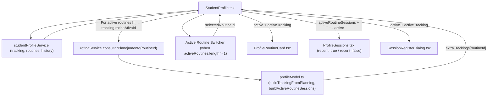

# Student Profile Active Routine and Sessions Redesign

*   **Author:** Regetz
*   **Status:** Approved
*   **Date:** 2026-11-03

--------------------------------------------------------------------------------

## Overview

In the Gymnasion web application, the Student Profile screen ([`StudentProfile.tsx`](file:///Users/regetz/Documents/Projetos/Gymnasion_web/src/pages/StudentProfile/StudentProfile.tsx)) serves as the Personal Trainer's primary workspace for managing an individual student's training plan and reviewing session execution. The default **Visão geral** (Overview) tab combines an active routine summary card ([`ProfileRoutineCard.tsx`](file:///Users/regetz/Documents/Projetos/Gymnasion_web/src/components/ProfileRoutineCard/ProfileRoutineCard.tsx)), an active routine sessions table ([`ProfileSessions.tsx`](file:///Users/regetz/Documents/Projetos/Gymnasion_web/src/components/ProfileSessions/ProfileSessions.tsx)), and a 330px right-hand KPI and evolution sidebar.

This design updates the active routine card, the sessions filter and table component, and the underlying profile model ([`profileModel.ts`](file:///Users/regetz/Documents/Projetos/Gymnasion_web/src/features/studentProfile/profileModel.ts)) to reduce visual clutter, eliminate horizontal table overflow, and support students who have more than one active routine at the same time—while leaving the profile header and the 330px KPI sidebar unchanged.

## The Problem

Personal Trainers currently face four usability and state-management issues on the Student Profile page:

1.  **Broken Multi-Routine Support:** A student can have multiple active routines simultaneously (for example, an aquatic endurance routine and a strength hypertrophy routine). However, [`StudentProfile.tsx`](file:///Users/regetz/Documents/Projetos/Gymnasion_web/src/pages/StudentProfile/StudentProfile.tsx#L72) uses `routines.find(r => r.ativo !== false)` to pick only the first active routine. Trainers cannot switch to a secondary active routine in the Overview tab, cannot filter its planned sessions, and cannot register a session for it via `+ Registrar sessão` ([`SessionRegisterDialog.tsx`](file:///Users/regetz/Documents/Projetos/Gymnasion_web/src/components/SessionRegisterDialog/SessionRegisterDialog.tsx)). Furthermore, in the **Rotinas** tab, secondary active routines receive `showWeek={true}` with `tracking={null}`, rendering an inaccurate `"Semana de referência · 0 de 0 sessões concluídas na semana"` grid.
2.  **Excessive Metadata in Metric Chips:** Each metric badge in [`ProfileRoutineCard.tsx`](file:///Users/regetz/Documents/Projetos/Gymnasion_web/src/components/ProfileRoutineCard/ProfileRoutineCard.tsx#L72-L84) prints four segments inline (`Title * · Type · Obrigatória/Opcional · Aluno/Personal/Ambos`). When a routine defines four to six metrics, these verbose chips wrap across multiple lines and dominate the routine card.
3.  **Crowded Session Filter Bar:** In [`ProfileSessions.tsx`](file:///Users/regetz/Documents/Projetos/Gymnasion_web/src/components/ProfileSessions/ProfileSessions.tsx#L202-L348), status filter pills, week filter pills (`Todas as semanas`, `Semana 1`, `Semana 2`, ...), and the search input share one flex container. Multi-week routines generate a long row of week pills that wraps awkwardly and crowds the search field.
4.  **Horizontal Table Overflow, Clipped Status Badges, and Duplicate Text:** Because the right-hand KPI sidebar consumes `330px`, the main column has approximately 680px–780px of horizontal space on standard laptop screens. Rendering 8 table columns (`Sessão / Atividades`, `Data`, `Duração`, two metric columns, `RPE`, `Status`, `Fonte`) inside that width forces horizontal scrolling and clips the right edge of status badges (`1 métrica(s) d...`). Additionally, when a session does not have a dedicated `sessionName`, the first column uses `activities[0].title` as the bold headline and immediately repeats `1. activities[0].title` on the subtitle line below it.

## Goals

*   **Multi-Routine Switching in Overview:** Allow the Personal Trainer to switch between all active routines (`routines.filter(r => r.ativo !== false)`) in the Overview tab, updating the displayed [`ProfileRoutineCard.tsx`](file:///Users/regetz/Documents/Projetos/Gymnasion_web/src/components/ProfileRoutineCard/ProfileRoutineCard.tsx), the [`ProfileSessions.tsx`](file:///Users/regetz/Documents/Projetos/Gymnasion_web/src/components/ProfileSessions/ProfileSessions.tsx) table, and the target routine of the `+ Registrar sessão` modal ([`SessionRegisterDialog.tsx`](file:///Users/regetz/Documents/Projetos/Gymnasion_web/src/components/SessionRegisterDialog/SessionRegisterDialog.tsx)).
*   **Accurate Per-Routine Weekly Progress:** Synthesize student-scoped tracking data for secondary active routines from [`rotinaService.ts`](file:///Users/regetz/Documents/Projetos/Gymnasion_web/src/services/rotinaService.ts) (`consultarPlanejamento`) combined with student session history, and guard the weekly reference grid in `ProfileRoutineCard` so it only renders when valid tracking sessions exist for that routine.
*   **Concise Metric Chips:** Display only the metric icon, metric name (`metric.titulo`), and metric type (`metricLabels[metric.tipo]`) inside each chip in `ProfileRoutineCard`, moving required/optional status and filler role (`Aluno`, `Personal`, `Ambos`) to the `title` tooltip and `aria-label`.
*   **Compact Session Filter Toolbar:** Group status filter pills on the left and replace the horizontal row of week pills with a compact `<select>` dropdown positioned next to the search input on the right, automatically resetting status, week, and page filters when the selected active routine changes.
*   **Overflow-Free Overview Table with Deduplicated Session Titles:** In Overview mode (`recent={true}`), eliminate duplicate activity text in the first column, consolidate `Data` and `Duração` into a single column, hide the `Fonte` column, and prevent status badges from clipping or wrapping.

## Non-Goals

*   Modifying the student profile header (`student-profile__header`), avatar, status badges, contact details, or header action buttons.
*   Modifying, resizing, or relocating the 330px right-hand KPI cards and mini-evolution chart (`student-profile__stats`).
*   Redesigning the **Evolução** tab ([`StudentEvolution.tsx`](file:///Users/regetz/Documents/Projetos/Gymnasion_web/src/components/StudentEvolution/StudentEvolution.tsx)).
*   Changing backend Spring Boot API contracts or database schemas.

## Open Questions

*   None. All scope boundaries, column consolidation rules, metric chip contents, and multi-routine switching behaviors have been resolved and verified.

## Critical User Journeys (CUJs)

### CUJ 1: Switching Between Multiple Active Routines in Overview

*   **Given:** A student has two active routines (`Periodização Aquática` and `Hipertrofia e Força Pura`), and the Personal Trainer opens `/alunos/:studentId` on the **Visão geral** tab.
*   **When:** The trainer clicks `Hipertrofia e Força Pura` in the active-routine selector bar above the routine card.
*   **Then:** `ProfileRoutineCard` updates to show the title, objective, metrics, and weekly progress of `Hipertrofia e Força Pura`; `ProfileSessions` resets its status filter to `"all"`, week filter to `"ALL"`, and page to `1`, displaying only the planned and completed sessions of `Hipertrofia e Força Pura` along with its primary metric columns; and clicking `+ Registrar sessão` opens `SessionRegisterDialog` bound to `Hipertrofia e Força Pura`.

### CUJ 2: Scanning Routine Metrics and Inspecting Metadata on Demand

*   **Given:** A Personal Trainer views a routine card with 5 configured metrics in either the **Visão geral** or **Rotinas** tab.
*   **When:** The trainer scans the metric chips and hovers over or focuses a specific metric chip (for example, `Tempo 100m Livre · Tempo`).
*   **Then:** The chip displays only the icon, `Tempo 100m Livre`, and `· Tempo` inline without wrapping into verbose multi-line blocks, while the native tooltip and `aria-label` expose `Tempo 100m Livre (Tempo) — Obrigatória · Preenchido por: Aluno`.

### CUJ 3: Filtering and Scanning Active Routine Sessions Without Horizontal Clipping

*   **Given:** A Personal Trainer views the `Sessões da rotina ativa` table on a 1280px–1440px laptop screen in the **Visão geral** tab, where sessions span multiple weeks and include sessions without a separate `sessionName`.
*   **When:** The trainer selects `Semana 4` from the week dropdown next to the search box and scans the session rows.
*   **Then:** The filter bar stays organized with status pills on the left and the week `<select>` + search input on the right; session rows without a custom `sessionName` do not repeat the first activity title twice; `Data` and `Duração` appear consolidated in one column; the `Fonte` column is hidden; and all `Status` badges (`Não realizada`, `Validada`, `1 métrica(s) do personal`) render completely without horizontal clipping.

## Technical Plan (Architecture)

### 1. Component & Data Flow Overview

The redesign operates within the existing student profile feature boundary ([`StudentProfile.tsx`](file:///Users/regetz/Documents/Projetos/Gymnasion_web/src/pages/StudentProfile/StudentProfile.tsx), [`ProfileRoutineCard.tsx`](file:///Users/regetz/Documents/Projetos/Gymnasion_web/src/components/ProfileRoutineCard/ProfileRoutineCard.tsx), [`ProfileSessions.tsx`](file:///Users/regetz/Documents/Projetos/Gymnasion_web/src/components/ProfileSessions/ProfileSessions.tsx), and [`profileModel.ts`](file:///Users/regetz/Documents/Projetos/Gymnasion_web/src/features/studentProfile/profileModel.ts)) plus [`rotinaService.ts`](file:///Users/regetz/Documents/Projetos/Gymnasion_web/src/services/rotinaService.ts) (`consultarPlanejamento`) for secondary active routines.

### 2. Architectural Responsibilities

1.  **Multi-Routine State & Tracking Synthesis (`StudentProfile.tsx` & `profileModel.ts`):**
    *   `StudentProfile.tsx` derives `activeRoutines = routines.filter(r => r.ativo !== false)` and tracks `selectedRoutineId` so the trainer can switch between active routines in the Overview tab.
    *   For any active routine whose ID differs from `tracking?.rotinaAtivaId`, `StudentProfile.tsx` fetches `rotinaService.consultarPlanejamento(r.id)` in parallel (guarded by the request-version counter `request === version.current`) and passes the result to `buildTrackingFromPlanning` in `profileModel.ts` to produce a student-scoped `StudentTracking` object without cross-student execution leakage.
    *   `ProfileRoutineCard.tsx` guards the weekly reference grid so it renders only when `showWeek && tracking && tracking.rotinaAtivaId === routine.id && tracking.sessoes.length > 0`.
2.  **Metric Chip Simplification (`ProfileRoutineCard.tsx`):**
    *   Each metric chip renders only the metric icon, name, and type inline, moving required/optional status and filler role to the `title` and `aria-label` attributes.
3.  **Filter Toolbar & Table Compaction (`ProfileSessions.tsx`):**
    *   Status filter pills remain on the left of the filter bar while a native week `<select>` dropdown is paired with the search input on the right. Switching `activeRoutine?.id` resets `statusFilter`, `weekFilter`, and `page`.
    *   In the **Histórico** tab (`recent={false}`), the scope filter pill labels the active filter clearly and scopes to all active routines or the selected active routine.
    *   Session cells deduplicate the first activity from the subtitle preview when `parsed.sessionName` is empty, and Overview mode (`recent={true}`) merges `Data` + `Duração` and hides `Fonte`.

## Alternatives Considered

### Alternative A: Stacking All Active Routines Vertically in the Overview Tab

*   **Pros:** Displays all active routines simultaneously without requiring a click to switch between them.
*   **Cons:** When a student has two or three active routines, stacking full `ProfileRoutineCard` components pushes the `ProfileSessions` table below the initial viewport fold and leaves it ambiguous which active routine's sessions and metric columns are shown in the table below.
*   **Reason for Rejection:** Rejected because it increases vertical clutter and fails to establish a clear 1:1 relationship between the inspected routine and the `Sessões da rotina ativa` table.

### Alternative B: Removing the Sessions Table or Filter Bar from the Overview Tab

*   **Pros:** Reduces the Overview tab to a high-level summary card and defers all filtering and session table inspection to the **Histórico** tab.
*   **Cons:** Forces the Personal Trainer to perform an extra tab switch on every visit just to filter pending or awaiting-validation sessions for the active routine.
*   **Reason for Rejection:** Rejected because the product owner explicitly requires operating session filters directly inside the Overview tab.

### Alternative C: Relocating the 330px Right-Hand KPI Sidebar into a Horizontal Row Above the Table

*   **Pros:** Gives `ProfileSessions` 100% of the page width (`~1100px+`), allowing all 8 table columns to fit without consolidation.
*   **Cons:** Alters the overall page grid layout (`student-profile__overview`) and moves the monthly KPI cards and evolution mini-chart away from their established right-hand sidebar position.
*   **Reason for Rejection:** Rejected per the explicit requirement to restrict changes strictly to the active routine and active sessions components.

### Alternative D: Keeping Week Filters as Horizontal Pill Buttons Inside a Scrollable Strip

*   **Pros:** Preserves single-click pill buttons for every week without opening a dropdown menu.
*   **Cons:** Routines with 6–12 weeks create a wide strip of repetitive buttons (`Semana 1`, `Semana 2`, ...) that competes visually with the primary status filter pills and crowds the search input.
*   **Reason for Rejection:** Rejected because a native `<select>` dropdown scales to any number of weeks in a fixed, compact footprint next to the search field.

--------------------------------------------------------------------------------

## Non-Functional Requirements

*   **Performance & Network Resilience:** Fetching `rotinaService.consultarPlanejamento(r.id)` is executed only for secondary active routines (`r.ativo !== false && r.id !== tracking?.rotinaAtivaId`) using `Promise.allSettled` and guarded by `if (request !== version.current) return;`. If a secondary planning call fails, the UI degrades gracefully without blocking the primary profile load or showing broken weekly grids.
*   **Accessibility (a11y):** The active-routine switcher uses semantic `role="tablist"` and buttons with `type="button"`, `role="tab"`, and `aria-selected`; the week `<select>` includes `aria-label="Filtrar por semana"`; and simplified metric chips include `tabIndex={0}`, `title={tooltip}`, and `aria-label={tooltip}`.

--------------------------------------------------------------------------------

## Detailed Implementation Plan

### Target Files to Create/Modify

#### 1. [`src/features/studentProfile/profileModel.ts`](file:///Users/regetz/Documents/Projetos/Gymnasion_web/src/features/studentProfile/profileModel.ts) (Modify)

*   **Type / Scope:** TypeScript Domain Model & Pure Data Transformation Utilities.
*   **Rationale:** Synthesize student-scoped `StudentTracking` objects for secondary active routines whose IDs do not match the single `rotinaAtivaId` returned by `studentProfileService.tracking(studentId)`.
*   **Proposed Changes:**
    *   Import `PlanejamentoRotinaResponseDTO` from `../../types/rotina`.
    *   Export pure helper function `buildTrackingFromPlanning(studentId: string, routine: RotinaResponse, planning: PlanejamentoRotinaResponseDTO, historySessions: TrainingSession[]): StudentTracking`:
        *   Filter `historySessions` to sessions belonging to `routine.id` and `studentId` (`const routineHistory = historySessions.filter(h => h.rotinaTreinoId === routine.id && (!h.desempenho?.alunoId || h.desempenho.alunoId === studentId))`).
        *   Flatten `planning.semanas` into planned sessions (`SessaoTreinoPlanejadaDTO`).
        *   Perform a two-pass match against `routineHistory` using a `usedHistoryIds = new Set<string>()`:
            1. Pass 1 (Exact ID match): match planned session `s` where `h.id === s.id` and record `usedHistoryIds.add(h.id)`.
            2. Pass 2 (Week + Date fallback): for unmatched planned sessions, match the first `h` in `routineHistory` where `!usedHistoryIds.has(h.id) && h.semana === s.semana && h.dataPlanejada === s.dataPlanejada`, recording `usedHistoryIds.add(h.id)`.
        *   Derive completion strictly from the matched student history entry `matchedHistory` (never trusting unverified `s.status === "CONCLUIDA"` from a shared routine planning DTO unless matched to `studentId`).
        *   Compute per-session `quantidadePendenciasPersonal` and `temPendenciasPersonal` by counting metrics on `routine.metricas` where `(m.quemPreenche === "PERSONAL" || m.quemPreenche === "AMBOS") && m.obrigatoria !== false` that lack a filled non-empty value in `matchedHistory.desempenho?.metricas` when the session is completed.
        *   Compute top-level `quantidadeMetricasPendentes` as the sum of `quantidadePendenciasPersonal` across the routine's sessions and return `{ alunoId: studentId, rotinaAtivaId: routine.id, quantidadeMetricasPendentes, sessoes }`.

#### 2. [`src/pages/StudentProfile/StudentProfile.tsx`](file:///Users/regetz/Documents/Projetos/Gymnasion_web/src/pages/StudentProfile/StudentProfile.tsx) (Modify)

*   **Type / Scope:** React Page Component.
*   **Rationale:** Enable inspecting and switching between multiple active routines in the Overview tab, supply accurate per-routine tracking to both Overview and Routines tabs, and bind `+ Registrar sessão` (`SessionRegisterDialog`) to the currently selected active routine.
*   **Proposed Changes:**
    *   Import `rotinaService` from `../../services/rotinaService` and `buildTrackingFromPlanning` from `../../features/studentProfile/profileModel`.
    *   Add state `selectedRoutineId: string` (`useState("")`) and `extraTrackings: Record<string, StudentTracking>` (`useState({})`).
    *   In `load()`, after `Promise.allSettled([tracking, routines, history])` resolves and passes `if (request !== version.current) return;`:
        *   Identify secondary active routines (`r.ativo !== false && r.id !== fetchedTracking?.rotinaAtivaId`).
        *   If secondary active routines exist, await `Promise.allSettled(secondaryRoutines.map(r => rotinaService.consultarPlanejamento(r.id)))`, verify `if (request !== version.current) return;` again, transform fulfilled results via `buildTrackingFromPlanning(studentId, r, planning, ownHistorySessions)`, and call `setExtraTrackings(nextExtraTrackings)` before `setLoading(false)`.
    *   Compute `activeRoutines = routines.filter(r => r.ativo !== false)`.
    *   Resolve `active = activeRoutines.find(r => r.id === selectedRoutineId) || activeRoutines.find(r => r.id === tracking?.rotinaAtivaId) || activeRoutines[0] || null`.
    *   Create helper `resolveRoutineTracking(r: RotinaResponse | null): StudentTracking | null` returning `tracking` when `tracking?.rotinaAtivaId === r?.id`, or `(r && extraTrackings[r.id]) || null` otherwise.
    *   Bind `activeTracking = resolveRoutineTracking(active)`.
    *   In the Overview tab (`tab === "overview"`), when `activeRoutines.length > 1`, render `
` containing `Rotinas ativas ({activeRoutines.length}):` and a `<button key={r.id} type="button" role="tab" aria-selected={active?.id === r.id} className="student-profile__routine-tab" onClick={() => setSelectedRoutineId(r.id)}>` per active routine (`r.titulo` + `<small>{r.frequenciaSemanal}x/sem</small>`).
    *   In the Routines tab (`tab === "routines"`), pass `tracking={r.ativo !== false ? resolveRoutineTracking(r) : null}` to each `ProfileRoutineCard`.

#### 3. [`src/pages/StudentProfile/StudentProfile.css`](file:///Users/regetz/Documents/Projetos/Gymnasion_web/src/pages/StudentProfile/StudentProfile.css) (Modify)

*   **Type / Scope:** CSS Stylesheet.
*   **Rationale:** Style the active-routine switcher bar in `.student-profile__main` without altering `.student-profile__header` or `.student-profile__overview` grid dimensions.
*   **Proposed Changes:**
    *   Add styles for `.student-profile__routine-switcher`, `.student-profile__routine-switcher-label`, and `.student-profile__routine-tab` (including `[aria-selected="true"]` active state using `--color-primary-500` and `--color-primary-50`, plus focus-visible and responsive flex-wrap rules).

#### 4. [`src/components/ProfileRoutineCard/ProfileRoutineCard.tsx`](file:///Users/regetz/Documents/Projetos/Gymnasion_web/src/components/ProfileRoutineCard/ProfileRoutineCard.tsx) (Modify)

*   **Type / Scope:** React Presentational Component.
*   **Rationale:** Reduce visual noise in metric chips to `Icon + Metric Name + Metric Type` (moving obligation and filler role to the native tooltip and `aria-label`) and prevent rendering a misleading `0 de 0` weekly reference grid when tracking data or planned sessions are absent.
*   **Proposed Changes:**
    *   In `.profile-routine__metrics`, render `` containing only ``, `<strong>{metric.titulo}</strong>`, and `<small>· {metricLabels[metric.tipo]}</small>`, where `tooltip` formats `${metric.titulo} (${metricLabels[metric.tipo]}) — ${obrigLabel}${filler ? ` · Preenchido por: ${filler}` : ""}`.
    *   Guard the weekly reference section with `{showWeek && Boolean(tracking && tracking.rotinaAtivaId === routine.id && tracking.sessoes.length > 0) && ( ... )}`.

#### 5. [`src/components/ProfileRoutineCard/ProfileRoutineCard.css`](file:///Users/regetz/Documents/Projetos/Gymnasion_web/src/components/ProfileRoutineCard/ProfileRoutineCard.css) (Modify)

*   **Type / Scope:** CSS Stylesheet.
*   **Rationale:** Refine spacing and focus/hover affordance on simplified metric chips and weekly reference header.
*   **Proposed Changes:**
    *   Update `.profile-routine__metrics > span` with border/hover transition (`cursor: default`, `:focus-visible` outline) and inline alignment so chips stay compact on single lines.

#### 6. [`src/components/ProfileSessions/ProfileSessions.tsx`](file:///Users/regetz/Documents/Projetos/Gymnasion_web/src/components/ProfileSessions/ProfileSessions.tsx) (Modify)

*   **Type / Scope:** React Presentational & Interactive Table Component.
*   **Rationale:** Reset stale status/week/page filters when switching active routines, reorganize the filter toolbar with a compact week `<select>` dropdown on the right, deduplicate activity text in the first column, and compact columns in Overview mode (`recent={true}`).
*   **Proposed Changes:**
    *   Import `useEffect` from `"react"` and reset `statusFilter` to `"all"`, `weekFilter` to `"ALL"`, and `page` to `1` when `activeRoutine?.id` changes.
    *   In the **Histórico** tab (`recent={false}`), label the active-routine scope pill `Somente: ${activeRoutine.titulo}` when `routines.filter(r => r.ativo !== false).length > 1` (or `"Somente rotina ativa"` when only one routine is active) so the trainer knows which routine is being filtered.
    *   Replace the `.profile-sessions__pills--weeks` button list with a `<select className="profile-sessions__week-select" aria-label="Filtrar por semana">` grouped inside `.profile-sessions__controls` alongside `.profile-sessions__search` on the right side of `.profile-sessions__filters`.
    *   In the table header (`<thead>`) and body (`<tbody>`):
        *   When `recent={true}`, omit the separate `Duração` column and append duration (`45 min · `) to the secondary line inside `.profile-sessions__date-cell`.
        *   When `recent={true}`, omit the `Fonte` column (`<th>Fonte</th>` and its `<td>`), keeping both `Duração` and `Fonte` as separate columns when `recent={false}` (**Histórico** tab).
    *   In the session cell (`<td>` 1), detect when `!parsed.sessionName && Boolean(parsed.activities[0]?.title)` and slice `parsed.activities.slice(1)` for `activitiesPreview` so the first activity is never printed twice in the same cell.

#### 7. [`src/components/ProfileSessions/ProfileSessions.css`](file:///Users/regetz/Documents/Projetos/Gymnasion_web/src/components/ProfileSessions/ProfileSessions.css) (Modify)

*   **Type / Scope:** CSS Stylesheet.
*   **Rationale:** Style the right-hand toolbar controls (`.profile-sessions__controls` and `.profile-sessions__week-select`), prevent status badge clipping (`white-space: nowrap`), and optimize table cell spacing in Overview mode.
*   **Proposed Changes:**
    *   Add `.profile-sessions__controls` (`display: flex; align-items: center; gap: 10px; flex-wrap: wrap;`) and `.profile-sessions__week-select` matching the pill/input height and border radius.
    *   Add `white-space: nowrap` to `.profile-sessions__status-badges` children and tighten `td`/`th` horizontal padding (`12px 14px`) so 6 columns fit inside the Overview main column without horizontal scrollbars on standard desktop viewports.

### Verification Plan

*   **Compilation/Build:** Run `npm run build` (`tsc -b && vite build`) and verify zero TypeScript or Vite bundling errors.
*   **Static Analysis & Linting:** Run `npm run lint` (`eslint .`) and verify zero ESLint warnings or errors across all modified files.
*   **Manual / UI Verification against CUJs:**
    *   Verify on `/alunos/:studentId` (**Visão geral** tab) with multiple active routines that the routine switcher renders, switches the active routine card and sessions table, resets status/week/page filtering, and binds `+ Registrar sessão` to the selected routine.
    *   Verify in `ProfileRoutineCard` that metric chips display only `Icon + Title · Type` and expose obligation + filler metadata on tooltip hover/focus.
    *   Verify in `ProfileSessions` (**Visão geral** tab) that the filter bar shows status pills on the left and the week `<select>` + search input on the right, session titles do not duplicate the first activity on the subtitle line, `Data` + `Duração` are consolidated, `Fonte` is hidden, and status badges do not clip.
    *   Verify in the **Histórico** tab (`recent={false}`) that full columns (`Data`, `Duração`, `Fonte`) remain intact.

--------------------------------------------------------------------------------

*Drafted with EGM*
